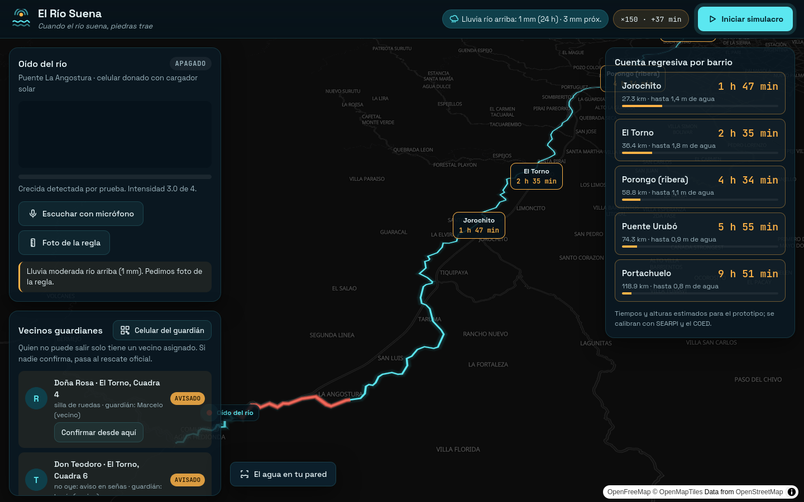
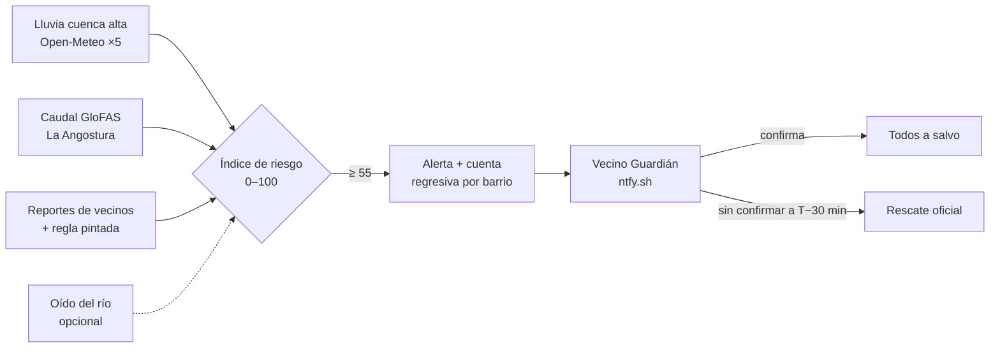

<p align="center"></p>

# 🌊 El Río Suena

> **Cuando el río suena, piedras trae.**
> Alerta de crecidas del río Piraí **por barrio** que usa datos abiertos, no necesita sensores y asigna un vecino guardián a cada persona que no puede evacuar sola.

<p align="center">
  <a href="https://neckhurtttt.github.io/el-rio-suena/?jurado"></a>
  
  
  
</p>
<p align="center">
  
  
  
  
  
  
</p>
<p align="center"><b>🇧🇴 Español</b> · <a href="#-english">🇬🇧 English</a> · <a href="#-中文">🇨🇳 中文</a> · 🎤 <a href="pitch-el-rio-suena.md">Guion del pitch</a> · 📊 <a href="El%20R%C3%ADo%20Suena%20%C2%B7%20Pitch.pptx">Presentación</a></p>


**▶ Demo en vivo:** https://neckhurtttt.github.io/el-rio-suena/?jurado. Tocar **Iniciar simulacro**: en `?jurado` el tiempo corre ×300.
**📱 Celular del guardián:** botón «Celular del guardián» → escanear el QR (`guardian.html?t=<tema>&p=rosa`).

Abstracthon 2026 · Equipo **Birria TECH** · Track **Ayuda Tecnológica**, que exige mezclar dos o más tracks. El proyecto vive en el cruce de:
- **Comunicación:** cambia la forma en que un barrio de la ribera se informa, se conecta y se coordina. Tiene la cuenta regresiva por barrio, los reportes de vecinos y el Vecino Guardián, que confirma con un toque.
- **Educación:** enseña a leer el riesgo con la regla pintada (lectura en 3 toques), el agua en tu pared y el índice 0–100 explicado en palabras simples.

🎥 **Video de respaldo (sin internet):** [capturas/demo-respaldo.mp4](capturas/demo-respaldo.mp4) · también en la [release v1.0-abstracthon](https://github.com/NeckHurtttt/el-rio-suena/releases/tag/v1.0-abstracthon).

---

## 😟 Problema
Las riadas del Piraí (la de El Torno fue un desastre departamental) y el fenómeno de El Niño 2026-27 ponen en riesgo a los barrios de la ribera. Hoy:

- Las alertas se dan **por colores y para todo el departamento**. Ninguna le dice a una cuadra concreta **cuánto tiempo le queda**.
- Muchas familias **no evacúan porque no creen** que el agua vaya a llegar a su casa.
- Los adultos mayores, las personas en silla de ruedas, las personas sordas y los niños solos dependen de que **alguien se acuerde de ellos**.

## 💡 Solución en 4 piezas

| | Pieza | Qué hace |
|---|---|---|
| 🛰️ | **Vigía del Piraí** | Cada 10 min revisa la lluvia en 5 puntos de la cuenca alta (Open-Meteo), el caudal GloFAS en La Angostura y los reportes de vecinos. Con eso calcula un **índice de riesgo de 0 a 100**. |
| ⏱️ | **Cuenta regresiva por barrio** | Mide la distancia sobre el cauce real del río (OSM) y muestra avisos como «el agua llega a El Torno en **2 h 20 min**». |
| 📷 | **El agua en tu pared** | Apuntas la cámara a tu casa y la app dibuja hasta dónde subiría el agua. Si no hay cámara, la muestra sobre una pared dibujada. |
| 🤝 | **Vecino Guardián** | Cada persona vulnerable tiene un vecino asignado. Cuando hay alerta, el celular del guardián suena y vibra, y el guardián confirma con un toque. **Si nadie confirma 30 min antes de que llegue el agua, el caso pasa al rescate oficial.** |

**Extra opcional:** el *oído del río*. Un celular junto a la orilla escucha el rugido grave del agua (20–300 Hz).

### ¿Por qué funciona? La ventaja de 2 h 30 min
La lluvia que cae en la cuenca alta (Samaipata, Bermejo, Cuevas…) tarda unas **2 h 30 min** en bajar hasta La Angostura. Si se mira **donde llueve** y no donde ya creció el río, se gana ese tiempo para evacuar.

## 🎬 Demo en 1 minuto (guion para el jurado)
1. Abrir `?jurado` → **Iniciar simulacro**: cae una tormenta en la cuenca alta.
2. El índice supera 55 → **ALERTA**, y cada barrio de la ribera muestra su cuenta regresiva.
3. El celular del guardián (QR) suena → toca **«Ya la ayudé ✓»**.
4. Cuando todos los guardianes confirman → pantalla **«Todos a salvo»**.

| 📱 El celular del guardián suena | 🧱 El agua sube en tu pared |
|:---:|:---:|
|  |  |

<details><summary>📸 Capturas fijas</summary>

| Alerta | Guardianes | Todos a salvo |
|---|---|---|
|  |  |  |
</details>

## ⚙️ Cómo funciona



- **Web estática, sin backend:** se publica en GitHub Pages y abre en cualquier celular.
- **Mapa:** MapLibre + OpenFreeMap, con el cauce real del Piraí sacado de OpenStreetMap.
- **Índice:** `indiceRiesgo` en `js/datos.js`. Si los únicos datos son reportes de vecinos, el índice **no** dispara la alerta, solo deja la zona en vigilancia (así se evitan las falsas alarmas).
- **Audio:** Web Audio con una FFT de 4096 muestras. Compara la energía entre 20 y 300 Hz con la línea base y avisa si la subida dura 1,5 s seguidos.
- **Canal a los guardianes:** ntfy.sh (pub/sub, también llega a la app ntfy), con BroadcastChannel como respaldo.
- **Plan B sin internet:** lluvia de respaldo, mapa liso, pared dibujada y simulacro con audio sintetizado. **La demo no se cae.**

## 📁 Estructura
```
index.html        app principal (mapa, índice, alerta, pared)
guardian.html     pantalla del celular del guardián
js/datos.js       barrios, guardianes de ejemplo, índice de riesgo
js/lluvia.js      Vigía: Open-Meteo (lluvia) + GloFAS (caudal)
js/mapa.js        MapLibre + cuenta regresiva sobre el cauce
js/cauce-pirai.js cauce del Piraí (OSM)
js/oido.js        oído del río (micrófono)
js/pared.js       el agua en tu pared (cámara)
js/canal.js       ntfy.sh + BroadcastChannel
pruebas.mjs       11 pruebas (índice, tiempos, canal)
```

## 🚀 Correrlo
```bash
python3 -m http.server 8765    # http://localhost:8765/?jurado
node pruebas.mjs               # 11 pruebas ok
```
- La cámara y el micrófono necesitan HTTPS o localhost.
- `?x=60` cambia la aceleración del tiempo (por defecto ×300 en `?jurado`).

## 🗺️ Lo que sigue
- [ ] Calibrar tiempos y alturas con **SEARPI** y el **COED**.
- [ ] Probar el canal ntfy con 2 celulares reales y un servidor ntfy propio.
- [ ] Avisos en **video LSB** y audios en **quechua y guaraní** grabados por hablantes.
- [ ] Registro de guardianes por junta vecinal.

## 🧭 Honestidad
- Las distancias, las velocidades y las alturas son **estimadas** hasta que se calibren con datos oficiales.
- El sistema **complementa** a las estaciones oficiales; no las reemplaza. La detección acústica es un prototipo, aunque el monitoreo acústico de crecidas sí se estudia en investigación.
- Las personas de la demo son ficticias. El tema público de ntfy sirve solo para la demo.

## 👥 Equipo Birria TECH
Sergio (desarrollo) · José Miguel Salinas (pitch, documentación y depuración) · Rodrigo Camacho (tester) · Deron Zuñiga (programación)

**Licencia:** [MIT](LICENSE) · **Datos:** Open-Meteo (pronóstico y Flood API/GloFAS) · © colaboradores de OpenStreetMap · OpenFreeMap.

---

## 🇬🇧 English
**When the river roars, it brings stones.** Early flood warning for the Piraí river (Santa Cruz, Bolivia), neighborhood by neighborhood, for people who can't evacuate alone. It needs no hardware.

- **Piraí Watch:** every 10 min it reads open data: rain at 5 upper-basin points (Open-Meteo), GloFAS discharge at La Angostura and neighbor reports. With that it computes a **0–100 risk index**. Rain in the upper basin takes about **2 h 30 min** to reach La Angostura, and that is the head start for evacuating.
- **Countdown per neighborhood**, measured along the real river channel: *"water reaches El Torno in 2 h 20 min"*.
- **Water on your wall:** point the camera at your house and see how high the water would rise.
- **Neighbor Guardian:** the guardian's phone rings and vibrates, and they confirm with one tap. If nobody confirms 30 min before the water arrives, the case goes to official rescue.
- **Optional extra:** a phone that *listens* to the river's low rumble (20–300 Hz).

Tracks: **Technology Aid** = **Communication** (neighborhood alerts, reports, guardians) + **Education** (painted gauge, water on your wall, plain-language risk index). Backup video: `capturas/demo-respaldo.mp4`. License: MIT.

Demo: open `?jurado` → **Iniciar simulacro**. Run locally: `python3 -m http.server 8765`, tests: `node pruebas.mjs`. Distances and heights are estimates until they are calibrated with SEARPI/COED. This complements official stations; it does not replace them.

## 🇨🇳 中文
**河水作响，必有石来。** 面向玻利维亚圣克鲁斯皮拉伊河沿岸的洪水预警系统：按社区倒计时，为无法独自撤离的人安排邻居守护者，无需任何硬件。

- **皮拉伊河守望**：每 10 分钟读取开放数据，包括上游流域 5 个点的降雨量（Open-Meteo）、La Angostura 的 GloFAS 流量和邻居上报，计算 **0–100 风险指数**。上游降雨约 **2 小时 30 分钟** 后到达 La Angostura，这就是争取到的撤离时间。
- **按社区倒计时**：沿真实河道计算，例如「洪水 2 小时 20 分钟后到达 El Torno」。
- **墙上的水位**：用手机摄像头对准自家墙面，显示水会涨到多高。
- **邻居守护者**：守护者的手机响铃并震动，一键确认；若洪水到达前 30 分钟仍无人确认，则转交官方救援。

赛道：**科技助力** = **沟通**（社区预警、邻居上报、守护者）+ **教育**（水尺读数、墙上水位、通俗风险指数）。备用视频：`capturas/demo-respaldo.mp4`。许可证：MIT。

演示：打开 `?jurado` → 点击 **Iniciar simulacro**。本地运行：`python3 -m http.server 8765`，测试：`node pruebas.mjs`。距离与水位均为估算，需要与 SEARPI/COED 校准；本系统是官方监测站的补充，不能替代它们。

