<p align="center"></p>

# El Río Suena

> **Cuando el río suena, piedras trae.**

**La madrugada del 13 de diciembre de 2025, el río Piraí entró en El Torno sin aviso: murieron 26 personas y los vecinos tuvieron que subirse a los techos.** El Río Suena es un sistema de alerta temprana para que eso no se repita. Le dice a **cada barrio cuántos minutos le quedan** antes de que llegue el agua y a **cada vecino a quién tiene que ir a buscar**.

<p align="center"></p>

<p align="center">
  <a href="https://neckhurtttt.github.io/el-rio-suena/?jurado"></a>
  
  
  
</p>
<p align="center">
  
  
  
  
  
  
</p>
<p align="center"><b>🇧🇴 Español</b> · <a href="#-english">🇬🇧 English</a> · <a href="#-中文">🇨🇳 中文</a> · <a href="#-guaraní">Guaraní</a> · <a href="#-runasimi-quechua">Runasimi (quechua)</a> · <a href="#-ayoreo">Ayoreo</a><br>
<sub>Cada idioma se despliega aquí mismo, sin recargar · Each language opens right here, no reload · 各语言在本页展开，无需刷新</sub><br>
🎤 <a href="pitch-el-rio-suena.md">Guion del pitch</a> · 📊 <a href="El%20R%C3%ADo%20Suena%20%C2%B7%20Pitch.pptx">Presentación</a></p>

### Cómo funciona, de un vistazo

<p align="center">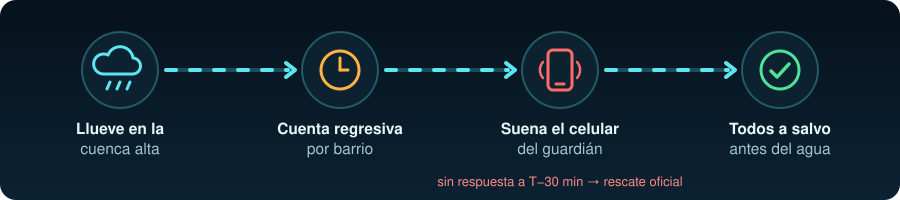</p>

### En 30 segundos

| | |
|---|---|
| **El problema** | Las alertas oficiales se emiten por colores y para todo el departamento. Ninguna le dice a una cuadra cuánto tiempo tiene, y quien no puede evacuar por sí mismo depende de que alguien se acuerde de él. |
| **Qué hacemos** | Vigilamos la lluvia donde cae, en la cuenca alta, y sumamos el aviso de vigías río arriba. Con eso calculamos una **cuenta regresiva por barrio** y le asignamos un **vecino guardián** a cada persona vulnerable. Si nadie confirma su traslado 30 minutos antes de que llegue el agua, el caso pasa al rescate oficial. |
| **Por qué creernos** | Lo probamos contra la riada real. Con datos abiertos únicamente, el sistema **no habría alertado**, y lo decimos. Con dos vigías río arriba, el aviso habría llegado **unas 4 horas antes** del desborde (estimación). La alerta y la confirmación ya funcionan en dos teléfonos reales. |
| **Cuánto cuesta** | **Bs 0 para las familias.** El piloto en una comunidad cuesta alrededor de Bs 1.500. Funciona **sin internet** y con los celulares que la gente ya tiene. |

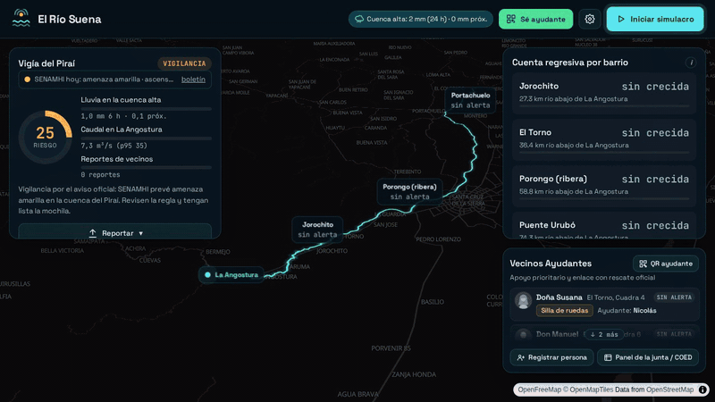

> [!IMPORTANT]
> **Qué buscamos:** un piloto en El Torno esta temporada de lluvias, con la junta vecinal, la Gobernación (COED) y SEARPI. La nota formal ya fue enviada: [`docs/carta-instituciones.md`](docs/carta-instituciones.md).

### Pruébelo en un minuto

> [!TIP]
> 1. Abra la **[demostración en vivo](https://neckhurtttt.github.io/el-rio-suena/?jurado)** y presione **Iniciar simulacro**. En el modo `?jurado` el tiempo corre 300 veces más rápido.
> 2. Presione **Sé guardián** y escanee el código QR con su celular (funciona incluso desde una videollamada). Toque **Activar avisos**.
> 3. Cuando su celular suene, toque **«Ya la ayudé»**: la central registra su respuesta en tiempo real.

Los botones **ES · EN · 中文** de la barra cambian el idioma de la interfaz sin recargar. **Video de respaldo** (sin conexión, 1 min 45 s, con subtítulos): [capturas/demo-respaldo.mp4](capturas/demo-respaldo.mp4), también en la [publicación v1.0-abstracthon](https://github.com/NeckHurtttt/el-rio-suena/releases/tag/v1.0-abstracthon).

Proyecto presentado en Abstracthon 2026 por el equipo **Birria TECH**, en el track **Ayuda Tecnológica**, que combina:

- **Comunicación:** cambia la manera en que un barrio ribereño se informa, se conecta y se coordina, con la cuenta regresiva por barrio, los reportes de vecinos y la confirmación del vecino guardián.
- **Educación:** enseña a leer el riesgo con la regla pintada (lectura en tres toques), el agua simulada sobre la pared de la propia casa y un índice de 0 a 100 explicado en lenguaje sencillo.

---

## Problema

En la madrugada del **13 de diciembre de 2025**, el río Piraí se desbordó en el municipio de **El Torno**. El alcalde informó posteriormente **26 fallecidos oficiales y al menos 1.300 familias damnificadas en 18 comunidades** ([El Deber vía eju.tv](https://eju.tv/?p=4852511)); la Gobernación declaró **desastre departamental**. Fue la riada de mayor magnitud en 42 años, desde el turbión de 1983 ([El Deber](https://eldeber.com.bo/santa-cruz/declaran-desastre-riada-historica-pirai-deja-20-muertos_1765881778), [Wikipedia](https://es.wikipedia.org/wiki/Turbi%C3%B3n_del_r%C3%ADo_Pira%C3%AD_de_1983)). El problema no se limita al Piraí: en la temporada 2024-2025, las lluvias afectaron a **más de 186.000 familias en Bolivia** y causaron 42 fallecimientos ([El País](https://elpais.bo/nacional/20250313_registran-42-fallecidos-por-las-lluvias-en-bolivia.html)). Ante el fenómeno de El Niño 2026-2027, el riesgo de repetición es alto.

En la actualidad:

- Las alertas se emiten **por colores y para todo el departamento**; ninguna indica a una zona concreta **cuánto tiempo dispone para evacuar**.
- Una parte de las familias **no evacúa porque no considera probable** que el agua alcance su vivienda.
- Las personas adultas mayores, con discapacidad física o auditiva y los niños que permanecen solos dependen de que **alguien recuerde acudir por ellos**.

### Evidencia del problema

Los testimonios publicados tras la riada confirman que la población no contó con tiempo de aviso:

> «El río nos sorprendió bastante, todo fue muy rápido. Tuvimos que subir como pudimos.»
> «Primero entró el agua, no pensamos que iba a ser así.»
> «Llegó el agua y nos subimos al techo.»
>
> — Vecinos y trabajadores de los distritos 6 y 7 de El Torno, 13/12/2025 ([El Deber vía eju.tv](https://eju.tv/?p=4841284))

En esa misma jornada, el Servicio Departamental de Salud informó **más de 20 personas rescatadas de los techos y más de 100 evacuadas**, y el colapso de dos puentes dejó comunidades aisladas (misma fuente).

El riesgo es recurrente: el **27 de marzo de 2026**, lluvias nocturnas volvieron a inundar El Torno; la corriente arrastró vehículos en la avenida principal y los vecinos *«expresaron su preocupación por la reiteración de estos eventos»* ([Los Tiempos/ABI](https://www.lostiempos.com/actualidad/pais/20260328/torno-sufre-nuevas-inundaciones-intensa-lluvia-santa-cruz)).

**Contexto nacional.** Entre 2014 y 2024, las inundaciones representaron el **40 % de los eventos adversos registrados en Bolivia** (4.280 incidentes), afectaron a **627.812 familias** y destruyeron más de 12.000 viviendas. En la temporada de 2025, las crecidas afectaron a más de 948.000 familias en 305 municipios, según datos del Viceministerio de Defensa Civil citados por Practical Action ([Brief de impacto: Programa para la Resiliencia ante Inundaciones, Bolivia 2021-2024](https://infohub.practicalaction.org/), Practical Action, 2025; [Estudio de caso: SAT Asunción del Quiquibey](https://infohub.practicalaction.org/), Practical Action, 2025).

**Respaldo al enfoque comunitario.** Los mismos estudios, realizados con más de 6.330 habitantes de 13 comunidades bolivianas en coordinación con el VIDECI y el SENAMHI, concluyen que:

- El **capital social de las comunidades es sólido**, aunque el financiero sea limitado, y se requieren **sistemas de alerta temprana centrados en las personas**. El vecino guardián de El Río Suena se apoya precisamente en ese capital social.
- En la comunidad de Asunción del Quiquibey (Beni), las alertas se recibieron **por WhatsApp** y se difundieron internamente por una red de altavoces, porque *«los procesos comunicacionales propios de la comunidad siguen siendo interpersonales»*. Durante las inundaciones de 2025, ese sistema permitió acciones preventivas.
- Practical Action probó con éxito **tecnologías de código abierto y bajo costo que complementan el sistema de alerta oficial** del SENAMHI, el mismo principio que sigue este proyecto.

No se identificaron encuestas públicas sobre percepción del riesgo o recepción de alertas específicas para la cuenca del Piraí; una encuesta en la ribera forma parte del plan del piloto.

## Público objetivo

| Destinatario | Beneficio |
|---|---|
| **Familias de la ribera** (El Torno, Jorochito, Porongo, Urubó, Portachuelo) | Una cuenta regresiva específica para su barrio y la visualización del nivel del agua sobre su propia vivienda |
| **Personas que no pueden evacuar por sí mismas**: adultos mayores, personas en silla de ruedas o con discapacidad auditiva, niños solos, hablantes de quechua | Un **vecino guardián** asignado; si no se confirma su traslado a tiempo, el caso se deriva al rescate oficial |
| **Guardianes** (vecinos voluntarios) | Un aviso que suena con la pantalla apagada y se confirma con un solo toque, con respaldo por SMS o llamada si no hay internet |
| **Vigías río arriba** (Bermejo, río Espejos) | Un reporte de dos toques para indicar que el río creció; observan lo que los satélites no detectan |
| **Instituciones que lo adoptan**: junta vecinal, Unidad de Gestión de Riesgos municipal, COED de la Gobernación, SEARPI | Un **panel en tiempo real** con el estado de cada persona, exportable a CSV o imprimible |

## Solución

| Componente | Función |
|---|---|
| **Vigía del Piraí** | Cada diez minutos consulta la precipitación en cinco puntos de la cuenca alta (Open-Meteo), el caudal GloFAS en La Angostura y los reportes de **vigías río arriba**, y calcula un **índice de riesgo de 0 a 100**. Cualquiera de las tres fuentes puede activar la alerta; dos reportes de vigías son suficientes. Además lee cada día hábil el **boletín hidrológico oficial de SENAMHI** (`herramientas/senamhi.py`, GitHub Action): con amenaza amarilla o naranja la zona pasa a vigilancia y con roja a alerta, de modo que la aplicación nunca contradice el aviso oficial. |
| **Cuenta regresiva por barrio** | Calcula la distancia sobre el cauce real del río (OpenStreetMap) y muestra avisos como «el agua llega a El Torno en **2 h 20 min**». |
| **El agua en su pared** | Con la cámara del teléfono, dibuja sobre la vivienda la altura que alcanzaría el agua. Sin cámara, la muestra sobre una pared ilustrada. |
| **Vecino guardián** | Cada persona vulnerable tiene un vecino asignado. Ante una alerta, el teléfono del guardián suena y vibra, y este confirma el traslado con un toque. **Si no hay confirmación 30 minutos antes de la llegada del agua, el caso se deriva al rescate oficial.** |
| **Aplicación para el celular** | `guardian.html` se instala como aplicación desde el navegador («Instalar como app», sin tienda), recuerda la comunidad de cada vecino, funciona sin internet y, con la aplicación gratuita ntfy, suena aunque el teléfono esté bloqueado. Quien no desea ser guardián puede entrar solo a mirar el río de su barrio. |
| **Registro compartido** | La junta vecinal registra, aprueba y supervisa a las personas desde cualquier dispositivo, con acceso protegido por clave (ver *Backend*). |

**Complemento experimental:** el *oído del río*, un teléfono ubicado junto a la orilla que analiza el sonido grave del caudal (20–300 Hz).

### Fundamento: la ventaja de 2 h 30 min

La lluvia que cae en la cuenca alta (Samaipata, Bermejo, Cuevas) tarda aproximadamente **2 h 30 min** en llegar a La Angostura. Al observar **dónde llueve** y no únicamente dónde ya creció el río, se obtiene ese tiempo para la evacuación.

## Validación con la riada del 13 de diciembre de 2025

Antes de adoptar el índice, se evaluó su comportamiento con los datos de la noche del desastre ([`herramientas/validar.py`](herramientas/validar.py); en la aplicación, botón **«¿Habría avisado la riada real?»**):

| Fuente abierta | Registro en la cuenca alta del Piraí, 12/12 06:00 a 13/12 07:00 |
|---|---|
| Open-Meteo best_match | 20 mm en total, máximo 3 mm/h |
| ECMWF IFS | 26 mm, máximo 2 mm/h |
| DWD ICON | 1 mm |
| NOAA GFS | 18 mm, máximo 3 mm/h |
| Caudal GloFAS en La Angostura | **sin aumento** (12 → 12 → 12 m³/s) |


**Ningún modelo global registró la tormenta local del Amboró.** Con datos abiertos únicamente, el índice no supera **2/100**; es decir, el sistema **no habría emitido la alerta**. Este resultado modificó el diseño:

- **Dos vigías río arriba** (Bermejo, río Espejos) que reporten el crecimiento del río **activan la alerta por sí solos**. Con el modelo de la aplicación (crecida rápida, escenario conservador), ello habría otorgado **aproximadamente 4 horas de anticipación** antes del desborde en El Torno. *La hora del reporte es hipotética, ya que se desconoce cuándo lo habría observado un vecino.*
- El umbral de caudal se ajustó con **42 años de datos GloFAS** (1984–2026: mediana de 11 m³/s, percentil 95 de 35 m³/s). El período anterior (2024–2026, percentil 95 de 17) generaba falsas alarmas.
- **Conclusión:** los modelos globales son útiles para tormentas de gran escala; las tormentas locales del Amboró las detectan **las personas**. Por ello el sistema combina datos abiertos, vigías, reglas pintadas y el oído del río.

## Diferenciación

| | Aviso **por barrio con minutos** | Detecta tormentas **locales** | Asiste a **quien no puede evacuar** | Funciona **sin internet** | Costo para la familia |
|---|:---:|:---:|:---:|:---:|:---:|
| Alerta oficial por colores (departamental) | No | Depende de estaciones | No | Radio y televisión | 0 |
| Pronósticos globales de crecidas (GloFAS, Google Flood Hub) | No (por tramo de río) | No (ver validación) | No | No | 0 |
| Grupos de WhatsApp del barrio | Ocasionalmente | Solo si alguien avisa | Solo si alguien lo recuerda | No | 0 |
| Sirenas | No | No | No (no llegan a personas sordas) | Sí | Alto (instalación) |
| **El Río Suena** | **Sí** | **Sí** (vigías, regla, oído) | **Sí** (guardián y derivación a T−30) | **Sí** (aplicación instalada y SMS) | **0** |

## Justificación tecnológica

| Tecnología | Motivo |
|---|---|
| **Aplicación web progresiva** (GitHub Pages, service worker) | Se abre con un enlace o código QR, se instala sin tienda de aplicaciones y **funciona sin internet**. No depende de un servidor que pueda fallar durante la crecida. |
| **Open-Meteo** (precipitación) y **GloFAS** (caudal) | Gratuitos, sin clave de acceso y con registro histórico para la validación. Adecuados para tormentas de gran escala. |
| **Vigías y regla pintada** | Cubren lo que los modelos no detectan (riada de 2025). Requieren únicamente un teléfono básico y pintura. |
| **ntfy** (notificaciones abiertas) | Suena con la pantalla apagada y no exige crear cuentas. Puede instalarse en un servidor propio del municipio. |
| **Supabase** (PostgreSQL) | Registro compartido de la junta vecinal sin servidor que mantener; acceso exclusivamente mediante funciones validadas y clave de la junta. |
| **SMS y llamada** | Respaldo ante la caída de internet; utilizan el plan del teléfono. |
| **MapLibre y OpenStreetMap** | Mapa abierto con el cauce real del Piraí; las zonas consultadas quedan almacenadas para su uso sin conexión. |
| **Web Audio y cámara** | El oído del río y la simulación sobre la pared se procesan en el propio teléfono, sin transmitir audio ni video. |

## Implementación

| Fase | Alcance | Responsables | Costo estimado |
|---|---|---|---|
| **0. Actual** | Prototipo funcional, validado con la riada de 2025 y probado en teléfonos reales | Birria TECH | 0 |
| **1. Piloto** (temporada de lluvias, diciembre a marzo) | El Torno: una junta vecinal, **10 vigías** río arriba, **5 reglas pintadas** en puentes, alrededor de 50 personas registradas y servidor ntfy propio. Calibración de tiempos y alturas con SEARPI y el COED | Junta vecinal, UGR de El Torno, SEARPI | Aproximadamente Bs 1.500 (pintura, servidor por cuatro meses, capacitación) |
| **2. Cuenca del Piraí** | Porongo, ribera de Santa Cruz, Urubó y Portachuelo; panel para el COED | Gobernación (COED) | Suscripción por tramo de río |
| **3. Alcance nacional** | Río Grande, Mamoré (Beni), Rocha (Cochabamba) y ríos de La Paz: únicamente se modifican el cauce, los puntos de la cuenca y los barrios | Municipios y Viceministerio de Defensa Civil | Equivalente por tramo |

**El servicio es gratuito para las familias.** Los costos son estimaciones del equipo y no constituyen cotizaciones.

**Gestiones institucionales:** el 21 de noviembre de 2026 se remitió una nota formal a la Gobernación de Santa Cruz (COED y Dirección de Gestión de Riesgos, con pedido de derivación al SEARPI) y al Gobierno Autónomo Municipal de El Torno, solicitando una reunión para calibrar el sistema y evaluar el piloto. Texto completo y estado: [`docs/carta-instituciones.md`](docs/carta-instituciones.md).

### Aplicabilidad nacional

- **Ningún componente es exclusivo del Piraí:** el cauce, los cinco puntos de precipitación, los barrios y el tiempo de tránsito del agua son **datos de configuración** (`js/datos.js`). Para otro río basta con modificar esos datos; la aplicación, los guardianes y el panel se mantienen.
- **Los datos abiertos cubren todo el territorio boliviano:** Open-Meteo y GloFAS tienen cobertura mundial, sin convenios ni sensores.
- **La red humana ya existe en todo el país:** juntas vecinales, OTB y Unidades de Gestión de Riesgos municipales. El Río Suena les proporciona una herramienta; no crea una estructura nueva.
- **Costo marginal reducido:** cada río adicional requiere una configuración y un piloto de aproximadamente Bs 1.500; el servidor de avisos es compartido.

### Backend: registro compartido de la junta vecinal (Supabase)

- Una persona registrada desde **cualquier teléfono** se incorpora al registro compartido de su comunidad y aparece en el panel de la junta en **aproximadamente 1,3 segundos** (aviso inmediato por ntfy y actualización periódica cada 30 segundos).
- La junta accede al panel con su **clave** (demostración: comunidad `demo`, clave `1312`), aprueba a cada persona y, desde ese momento, esta recibe las alertas. Cada persona aprobada dispone de su propio **código QR de guardián**.
- **Privacidad:** las tablas no pueden leerse con la clave pública (seguridad a nivel de fila sin políticas de acceso). Todas las operaciones se realizan mediante funciones (`rs_registrar`, `rs_listar`, `rs_aprobar`, `rs_quitar`) que validan los datos y exigen la clave de la junta para consultar o aprobar. La clave se almacena cifrada con bcrypt.
- **Sin conexión**, el registro se guarda en el teléfono y se envía automáticamente al restablecerse la conexión; la central conserva la última copia disponible.
- Esquema completo: [`supabase/esquema.sql`](supabase/esquema.sql). Prueba integral realizada: registro en un teléfono, aparición en la central en 1,3 s, aprobación, código QR del guardián, alerta y confirmación de vuelta en 3 segundos.

## Impacto y medición

- **Tiempo de anticipación:** aproximadamente 4 horas antes del desborde de 2025 con vigías (estimación con hora de reporte hipotética); 2 h 30 min cuando los modelos registran la lluvia.
- **Cobertura:** porcentaje de personas registradas cuyo traslado se confirma antes de la llegada del agua (meta del piloto: 100 %; los casos restantes se derivan al rescate a T−30 min).
- **Margen:** minutos promedio entre la confirmación y la llegada del agua, calculados en la pantalla de cierre del simulacro.
- **Tiempo de respuesta del guardián:** la central lo registra en tiempo real. En la prueba del 21 de noviembre de 2026, dos teléfonos reales (Android e iPhone) recibieron la alerta y confirmaron el traslado.
- **Falsas alarmas:** alertas emitidas sin crecida por temporada, a registrar durante el piloto con SEARPI.
- **Escala:** solo en El Torno hubo al menos 1.300 familias damnificadas en 2025; el piloto registrará a las personas que no pueden evacuar por sí mismas en una comunidad y luego se extenderá a las 18.
- **Costo para la familia:** Bs 0.

## Guion de demostración (un minuto)

1. Abrir `?jurado` y presionar **Iniciar simulacro**: se simula una tormenta en la cuenca alta.
2. El índice supera 55, se emite la **alerta** y cada barrio muestra su cuenta regresiva.
3. El teléfono del guardián (código QR **Sé guardián**) suena; el guardián presiona **«Ya la ayudé»** y la central muestra el tiempo de respuesta.
4. Cuando todos los guardianes confirman, aparece la pantalla de cierre con las personas trasladadas, el margen y el costo.
5. **«¿Habría avisado la riada real del 13/12/2025?»** muestra la gráfica de esa noche, hora por hora.
6. **Panel de la junta**: se ingresa la clave `1312`; las personas registradas desde otro teléfono aparecen en vivo y pueden aprobarse o exportarse a CSV.
7. Sin conexión, la aplicación instalada sigue abriendo y desde cada persona se puede enviar un SMS o llamar al guardián.

| Teléfono del guardián | Nivel del agua sobre la vivienda |
|:---:|:---:|
|  |  |

<details><summary>Capturas fijas</summary>

| Registro compartido de la junta | Alerta |
|---|---|
| 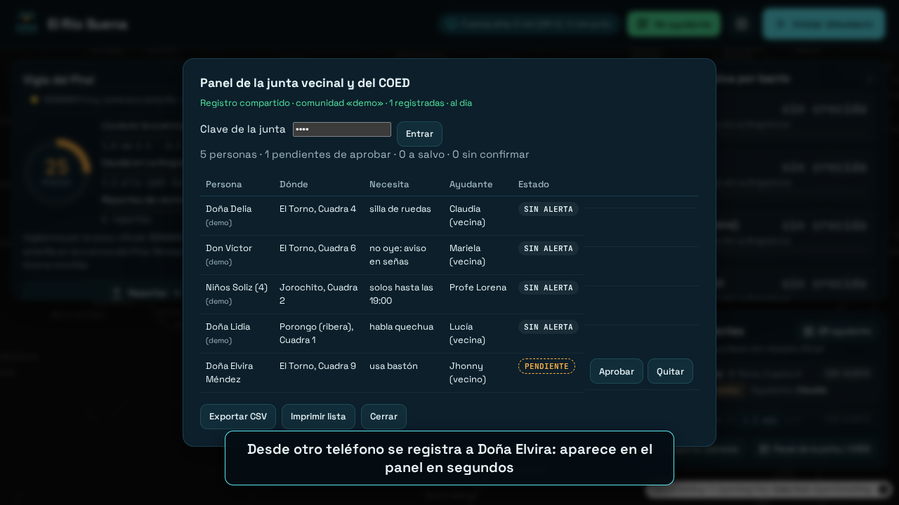 |  |
| **Respuestas de los guardianes** | **Cierre del simulacro** |
|  |  |
</details>

## Arquitectura

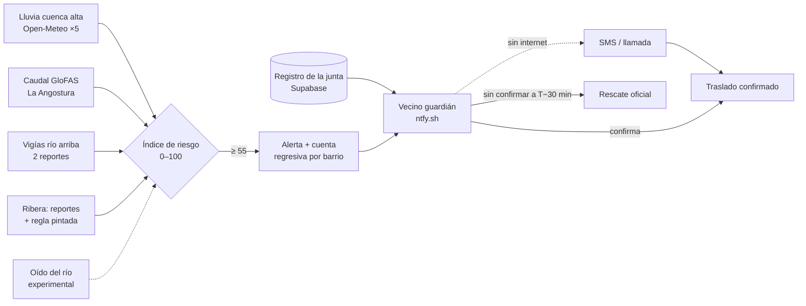

- **Interfaz:** aplicación web estática publicada en GitHub Pages, compatible con cualquier teléfono.
- **Mapa:** MapLibre y OpenFreeMap, con el cauce real del Piraí obtenido de OpenStreetMap.
- **Índice:** función `indiceRiesgo` en `js/datos.js`. Tres fuentes pueden activar la alerta: precipitación, caudal y **dos vigías río arriba**. Los reportes de la ribera por sí solos **no** activan la alerta; únicamente colocan la zona en vigilancia, para evitar falsas alarmas.
- **Audio:** Web Audio con una FFT de 4096 muestras; compara la energía entre 20 y 300 Hz con la línea base y señala un aumento sostenido durante 1,5 segundos.
- **Canal con los guardianes:** ntfy.sh (publicación y suscripción, compatible con la aplicación ntfy), con BroadcastChannel como respaldo local.
- **Registro compartido:** `js/nube.js` y `js/registro.js` con Supabase; funciones RPC definidas en `supabase/esquema.sql`.
- **Vigía central:** una PC del equipo corre `recolector/` cada 10 min (Tarea programada en Windows) y sube la lectura de la cuenca a Supabase (`rs_lecturas`, con token propio). La app la usa si tiene menos de 20 min; si no, cada navegador escanea por su cuenta, así que esa PC no es un punto único de falla. Ver [recolector/README.md](recolector/README.md).
- **Funcionamiento sin conexión:** `sw.js` almacena la aplicación, la última consulta de datos y el mapa visitado; los guardianes cuentan con SMS y llamada de respaldo.
- **Idiomas:** `js/idioma.js` traduce la interfaz al inglés y al chino con los botones **ES · EN · 中文**, sin recargar; `?lang=en` y `?lang=zh` abren la interfaz en ese idioma. Los mensajes para los guardianes (SMS/ntfy) y el CSV permanecen en castellano, el idioma de la ribera.
- **Accesibilidad:** botón **Aa** (letra grande y alto contraste) y lectura del aviso en voz alta, en el idioma elegido.

## Estructura del repositorio

```
index.html             aplicación principal (mapa, índice, alerta, pared)
guardian.html          aplicación del celular (guardián o vecino que solo mira)
movil.webmanifest      instalación de la aplicación del celular
datos/senamhi.json     boletín oficial de SENAMHI ya procesado (se actualiza solo)
js/datos.js            barrios, personas de ejemplo, índice de riesgo
js/lluvia.js           Vigía: Open-Meteo (precipitación) y GloFAS (caudal)
js/mapa.js             MapLibre y cuenta regresiva sobre el cauce
js/cauce-pirai.js      cauce del Piraí (OpenStreetMap)
js/oido.js             oído del río (micrófono)
js/pared.js            simulación del agua sobre la pared (cámara)
js/canal.js            ntfy.sh y BroadcastChannel
js/registro.js         registro de personas, aprobación y CSV
js/nube.js             conexión con el registro compartido (Supabase)
js/historico.js        riada del 12–13/12/2025 (datos abiertos)
js/idioma.js           interfaz en castellano, inglés y chino
supabase/esquema.sql   tablas y funciones del registro compartido
sw.js                  funcionamiento sin conexión (PWA)
nodo/                  nodo comunitario: ntfy propio, túnel y vigía por Telegram con Whisper
herramientas/validar.py  reproduce la validación con Open-Meteo
pruebas.mjs            18 pruebas automatizadas (índice, riada, tiempos, canal, PWA, CSV, idiomas)
```

## Ejecución local

```bash
python3 -m http.server 8765      # http://localhost:8765/?jurado
node pruebas.mjs                 # pruebas automatizadas
python3 herramientas/validar.py  # riada de 2025 y 42 años de GloFAS
```

- La cámara y el micrófono requieren HTTPS o `localhost`.
- El parámetro `?x=60` modifica la aceleración del tiempo (por defecto ×300 en `?jurado`). Los parámetros `?lang=en` y `?lang=zh` abren la interfaz en inglés o chino.
- Para otra comunidad o junta: parámetro `?c=<comunidad>` y una fila nueva en `rs_juntas`.

## Nodo comunitario: el vigía manda un audio

Una PC de la junta o del COED funciona como **servidor de la comunidad**, con IA que corre ahí mismo, sin nube extranjera ni costo por mensaje ([`nodo/`](nodo/README.md)):

- **ntfy propio + túnel de Cloudflare.** Los avisos salen de un servidor de la comunidad; la app publica a la vez en ntfy.sh, así que si el nodo se cae los avisos siguen.
- **Vigía por Telegram.** El vigía río arriba manda un **audio** («el río está creciendo, ya tapa la piedra grande»). **Whisper** lo transcribe en la PC, se decide si es un reporte de crecida (reglas o un modelo local con Ollama) y la central lo cuenta como vigía, con lo que dijo a la vista. No hay que instalar ninguna app: un audio es lo que la gente ya manda.
- **Mismas reglas de seguridad:** solo cuentan los vigías dados de alta por la junta, y hacen falta dos vigías distintos para la alerta.

Instalación con Docker en unos 20 minutos: [`nodo/README.md`](nodo/README.md).

## Próximos pasos

- [ ] Calibrar tiempos y alturas con **SEARPI** y el **COED**.
- [x] Probar el canal de avisos con dos teléfonos reales (realizado el 21/11/2026).
- [x] Registro compartido de la junta vecinal con base de datos (Supabase).
- [x] Funcionamiento sin conexión con respaldo por SMS y llamada.
- [ ] Instalar un servidor ntfy propio para el piloto.
- [x] Interfaz en castellano, inglés y chino; documentación también en guaraní y quechua (borradores para revisar con hablantes).
- [ ] Documentación en **ayoreo** escrita con hablantes ayoreo.
- [ ] Avisos en **video en Lengua de Señas Boliviana** y audios en **quechua y guaraní** grabados por hablantes.
- [ ] Conformar la red de vigías río arriba con la junta (Bermejo, río Espejos) y probarla en temporada de lluvias.
- [ ] Incorporar precipitación satelital de alta resolución (GPM IMERG) para tormentas locales.

## Limitaciones

- Las distancias, velocidades y alturas son **estimaciones** hasta su calibración con datos oficiales.
- Con datos abiertos únicamente, el sistema **no habría alertado** la riada del 13/12/2025 (ver *Validación*). La anticipación de aproximadamente 4 horas con vigías es una estimación basada en una hora de reporte hipotética.
- El sistema **complementa** a las estaciones oficiales; no las reemplaza. La detección acústica es un prototipo, si bien el monitoreo acústico de crecidas es objeto de investigación.
- Las personas de la demostración son ficticias. El tema público de ntfy y la clave `1312` se utilizan únicamente con fines de demostración.

## Equipo Birria TECH

Sergio (desarrollo) · José Miguel Salinas (pitch, documentación y depuración) · Rodrigo Camacho (pruebas) · Deron Zuñiga (programación)

**Licencia:** [MIT](LICENSE) · **Datos:** Open-Meteo (pronóstico y Flood API/GloFAS) · © colaboradores de OpenStreetMap · OpenFreeMap.

---

## 🇬🇧 English

<details>
<summary><br><b>▶ Open the full documentation in English</b> · opens right here, no page reload</summary>

> **When the river roars, it brings stones.**

**In the early hours of 13 December 2025, the Piraí river swept into El Torno without warning: 26 people died and neighbors had to climb onto their roofs.** El Río Suena is an early-warning system so that this doesn’t happen again. It tells **each neighborhood how many minutes it has left** before the water arrives and **each neighbor who they have to go and get**.

<p align="center"></p>

<p align="center">
  <a href="https://neckhurtttt.github.io/el-rio-suena/?jurado&lang=en"></a>
  
  
  
</p>

#### How it works, at a glance

<p align="center">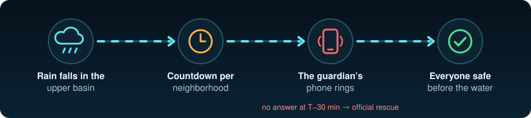</p>

#### In 30 seconds

| | |
|---|---|
| **The problem** | Official alerts are issued by color and for the whole department. None of them tells a block how much time it has, and people who can’t evacuate alone depend on someone remembering them. |
| **What we do** | We watch the rain where it falls, in the upper basin, and add reports from upstream watchers. With that we compute a **countdown per neighborhood** and assign a **neighbor guardian** to every vulnerable person. If nobody confirms 30 minutes before the water arrives, the case goes to official rescue. |
| **Why trust it** | We tested it against the real flood. With open data alone it **would not have warned**, and we say so. With two upstream watchers, the warning would have come **about 4 hours before** the overflow (estimate). Alert and confirmation already work on two real phones. |
| **What it costs** | **Bs 0 for families.** A pilot in one community costs about Bs 1,500. It works **offline**, on phones people already have. |

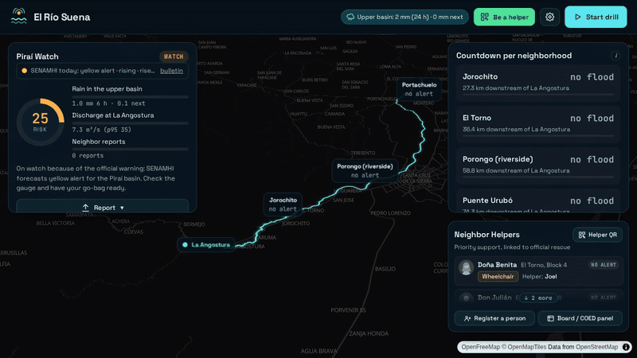

> [!IMPORTANT]
> **What we’re looking for:** a pilot in El Torno this rainy season, with the neighborhood board, the Departmental Government (COED) and SEARPI. The formal letter has already been sent: [`docs/carta-instituciones.md`](docs/carta-instituciones.md) (Spanish).

#### Try it in one minute

> [!TIP]
> 1. Open the **[live demo](https://neckhurtttt.github.io/el-rio-suena/?jurado&lang=en)** and press **Start drill**. In `?jurado` mode, time runs 300 times faster.
> 2. Press **Be a guardian** and scan the QR code with your phone (it even works over a video call). Tap **Turn on alerts**.
> 3. When your phone rings, tap **“I helped her”**: the control room logs your response in real time.

The **ES · EN · 中文** buttons in the top bar switch the interface language without reloading. **Backup video** (offline): [capturas/en/demo-respaldo.mp4](capturas/en/demo-respaldo.mp4).

Presented at Abstracthon 2026 by team **Birria TECH**, in the **Technology Aid** track, combining:
- **Communication:** it changes how a riverside neighborhood gets informed, connects and coordinates: the countdown per neighborhood, neighbor reports and the guardian’s one-tap confirmation.
- **Education:** it teaches people to read risk with the painted gauge (read in 3 taps), the water drawn on their own wall and a 0–100 index explained in plain words.

---

### 😟 Problem
In the early hours of **13 December 2025** the Piraí overflowed in **El Torno**: at least **20 dead** and dozens missing ([France 24/AFP](https://www.france24.com/es/minuto-a-minuto/20251215-al-menos-20-muertos-y-decenas-de-desaparecidos-por-el-desborde-de-un-r%C3%ADo-en-bolivia)), about **600 families affected** in 11 communities ([El País](https://elpais.bo/nacional/20251217_hay-cerca-de-600-familias-afectadas-en-el-torno.html)) and a **departmental disaster** declaration. It was the largest flood in 42 years, since the 1983 *turbión* ([El Deber](https://eldeber.com.bo/santa-cruz/declaran-desastre-riada-historica-pirai-deja-20-muertos_1765881778), [Wikipedia](https://es.wikipedia.org/wiki/Turbi%C3%B3n_del_r%C3%ADo_Pira%C3%AD_de_1983)). Days later, the mayor of El Torno counted **26 official deaths and at least 1,300 families affected in 18 communities** ([El Deber via eju.tv](https://eju.tv/?p=4852511)). And it is not only the Piraí: in the 2024-25 season, rain affected **more than 186,000 families in Bolivia** and left 42 dead ([El País](https://elpais.bo/nacional/20250313_registran-42-fallecidos-por-las-lluvias-en-bolivia.html)). With El Niño 2026-27 it can happen again. Today:

- Alerts are issued **by color and for the whole department**. None of them tells a specific block **how much time it has left**.
- Many families **don’t evacuate because they don’t believe** the water will reach their house.
- Older people, wheelchair users, deaf people and children home alone depend on **someone remembering them**.

### 🎯 Who is it for?
| Who | What they get |
|---|---|
| 🏠 **Riverside families** (El Torno, Jorochito, Porongo, Urubó, Portachuelo) | A countdown for **their** neighborhood, and the water shown **on their own wall** |
| ♿ **People who can’t evacuate alone**: older people, wheelchair users, deaf people, children home alone, Quechua speakers | An assigned **neighbor guardian**; if nobody confirms, the case goes to official rescue |
| 🙋 **Guardians** (neighbors) | An alert that rings with the screen off and is confirmed with **one tap** (or by SMS/call when there is no internet) |
| 👀 **Upstream watchers** (Bermejo, Espejos river) | Two taps to report “the river rose”; they see what satellites can’t |
| 🏛️ **Whoever adopts it**: neighborhood board, municipality (UGR), the Departmental Government’s COED, SEARPI | A **live panel** of who is still missing, exportable to CSV or printed |

### 💡 The solution in 4 pieces

| | Piece | What it does |
|---|---|---|
| 🛰️ | **Piraí Watch** | Every 10 min it checks the rain at 5 points of the upper basin (Open-Meteo), the GloFAS discharge at La Angostura and the reports from **upstream watchers**. With that it computes a **risk index from 0 to 100**. Any of the three sources can trigger the alert (2 watchers are enough). It also reads the **official SENAMHI hydrological bulletin** every weekday: yellow or orange puts the area on watch, red triggers the alert, so the app never contradicts the official warning. |
| ⏱️ | **Countdown per neighborhood** | It measures the distance along the real river channel (OSM) and shows messages like “water reaches El Torno in **2 h 20 min**”. |
| 📷 | **Water on your wall** | Point the camera at your house and the app draws how high the water would rise. Without a camera, it shows it on a drawn wall. |
| 🤝 | **Neighbor Guardian** | Every vulnerable person has an assigned neighbor. When there is an alert, the guardian’s phone rings and vibrates, and the guardian confirms with one tap. **If nobody confirms 30 min before the water arrives, the case goes to official rescue.** |
| 📱 | **Phone app** | Installs from the browser («Install as app», no store), remembers each neighbor’s community, works offline and, with the free ntfy app, rings even when the phone is locked. Anyone can open it just to watch the river. |

**Optional extra:** the *river ear*. A phone by the riverbank listens for the water’s low rumble (20–300 Hz).

#### Why it works: the 2 h 30 min head start
Rain that falls on the upper basin (Samaipata, Bermejo, Cuevas…) takes about **2 h 30 min** to reach La Angostura. Watching **where it rains**, not where the river has already risen, buys that time to evacuate.

### 🔬 Validation against the real flood of 13 Dec 2025
Before trusting the index, we tested it against the night of the tragedy ([`herramientas/validar.py`](herramientas/validar.py), and the **“Would it have warned of the real flood?”** button in the app):

| Open source | What it saw in the upper Piraí basin, 12 Dec 06:00 → 13 Dec 07:00 |
|---|---|
| Open-Meteo best_match | 20 mm in total, max 3 mm/h |
| ECMWF IFS | 26 mm, max 2 mm/h |
| DWD ICON | 1 mm |
| NOAA GFS | 18 mm, max 3 mm/h |
| GloFAS discharge at La Angostura | **did not rise** (12 → 12 → 12 m³/s) |

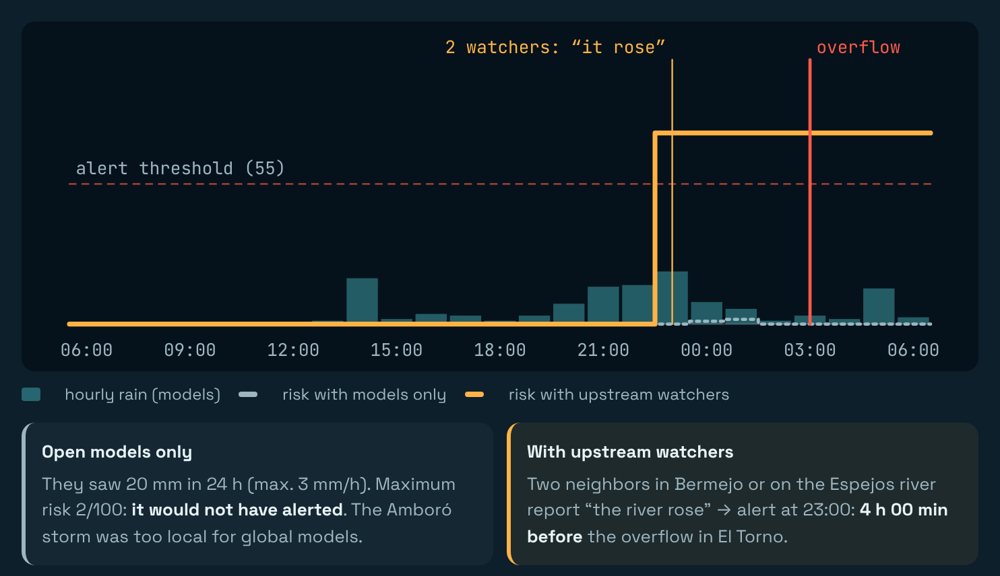

**No global model saw the Amboró storm.** With open data alone, the index never goes above **2/100**: El Río Suena **would not have warned**. We say it plainly because it changed the design:

- Now **2 upstream watchers** (Bermejo, Espejos river) reporting “the river rose” **trigger the alert on their own**. With the app’s model (fast flood, conservative case), that would have given **~4 h of warning** before the overflow in El Torno. *The report time is hypothetical: we don’t know when a neighbor would have seen it.*
- We also tuned the discharge threshold with **42 years of GloFAS** (1984–2026: median 11 m³/s, p95 35 m³/s). Before, we used 2024–2026 (p95 17), and that caused false alarms.
- **Lesson:** global models work for large storms; local Amboró storms are seen by **people**. That’s why the system combines open data, watchers, painted gauges and the river ear.

### 🆚 How is it different?
| | Alert **per neighborhood, in minutes** | Sees **local** storms | Helps **those who can’t leave** | **Offline** | Cost for families |
|---|:---:|:---:|:---:|:---:|:---:|
| Official color alert (departmental) | ❌ | depends on stations | ❌ | radio/TV | 0 |
| Global flood forecasts (GloFAS, Google Flood Hub) | ❌ (per river reach) | ❌ (see above) | ❌ | ❌ | 0 |
| Neighborhood WhatsApp groups | sometimes | if someone warns | if someone remembers | ❌ | 0 |
| Sirens | ❌ | ❌ | ❌ (deaf people can’t hear them) | ✅ | high (installation) |
| **El Río Suena** | ✅ | ✅ watchers + gauge + ear | ✅ guardian + rescue at T−30 | ✅ installed app + SMS | **0** |

### 🧰 Why these technologies?
| Technology | Why |
|---|---|
| **Static web + PWA** (GitHub Pages, service worker) | Opens from a link or QR code, installs without an app store and **works offline**. There is no server that can go down in the middle of a flood |
| **Open-Meteo** (rain) and **GloFAS** (discharge) | Free, no key, with history for validation. They work for large storms |
| **Watchers + painted gauge** | Cover what the models miss (2025 flood). They only need a basic phone and paint |
| **ntfy** (open push) | Rings with the screen off and needs no accounts. It can run on the municipality’s own server |
| **SMS / call** | Backup when the internet goes down; uses the phone plan |
| **MapLibre + OpenStreetMap** | Open map with the real Piraí channel; tiles already seen stay saved |
| **Web Audio / camera** | The river ear and the water on your wall run on the phone, without sending audio or video to anyone |

### 🏗️ How it is rolled out
| Phase | What | Who | Estimated cost |
|---|---|---|---|
| **0 · Today** | Working prototype, validated against the 2025 flood | Birria TECH | 0 |
| **1 · Pilot** (rainy season Dec–Mar) | El Torno: 1 neighborhood board, **10 upstream watchers**, **5 painted gauges** on bridges, ~50 registered people, own ntfy server. Calibrate times and heights with SEARPI and COED | Neighborhood board + UGR El Torno + SEARPI | ≈ Bs 1,500 (paint, VPS for 4 months, training) |
| **2 · The whole Piraí** | Porongo, Santa Cruz (riverside), Urubó, Portachuelo; COED panel | Departmental Government (COED) | subscription per river reach |
| **3 · Nationwide** | Río Grande, Mamoré (Beni), Rocha (Cochabamba), rivers of La Paz: only the channel, the basin points and the neighborhoods change | Municipalities + Vice Ministry of Civil Defense | same |

**Always free for families.** Costs are the team’s estimates, not quotes.

#### 🇧🇴 Why it works for the whole country
- **Nothing is specific to the Piraí:** the channel, the 5 rain points of the upper basin, the neighborhoods and the water’s travel time are **configuration data** (`js/datos.js`). For another river you change that data; the app, the guardians and the panel stay the same.
- **Open data covers all of Bolivia:** Open-Meteo (rain) and GloFAS (discharge) have worldwide coverage, with no agreements or sensors.
- **The human network already exists everywhere:** neighborhood boards, OTBs and municipal Risk Management Units. El Río Suena gives them a tool; it doesn’t create a new structure.
- **Near-zero marginal cost:** each new river is a configuration + a pilot of ≈Bs 1,500; the alert server is the same.

#### 🗄️ Backend: the board’s shared register (Supabase)
- Whoever registers a person from **any phone** sends them to their community’s shared register; the control room and the board see them **in ~2 s** (ntfy notice + refresh every 30 s).
- The board signs in to the panel with its **key** (demo: community `demo`, key `1312`), approves, and from then on the person receives alerts. Every approved person has a **guardian QR code**.
- **Privacy:** the tables cannot be read with the public key (RLS with no policies). Everything goes through functions (`rs_registrar`, `rs_listar`, `rs_aprobar`, `rs_quitar`) that validate the data and require the board’s key to view or approve. The key is stored with bcrypt.
- **Offline** it is saved on the phone and sent automatically when the connection comes back; the control room keeps the last copy.
- Full schema: [`supabase/esquema.sql`](supabase/esquema.sql). Tested end to end: sign-up on a phone → shows up in the control room in 1.3 s → approval → guardian QR → alert → “safe” back in 0:03.

### 📈 Impact and how we measure it
- **Warning time:** ~4 h before the overflow in the 2025 flood with watchers (hypothetical); **2 h 30 min** with rain seen by the models.
- **Nobody forgotten:** % of registered people confirmed before the water (pilot goal: **100 %**; the rest go to rescue at T−30 min).
- **Margin:** average minutes between confirmation and the water’s arrival (the “Everyone safe” screen computes it).
- **False alarms:** alerts without a flood per season (counted in the pilot with SEARPI).
- **Cost for families:** Bs 0.
- **Real guardian response time:** the control room shows it live (“safe · 1:39 after the alert”). Test on 21 Nov 2026 with 2 real phones (Android + iPhone): both got the alert and confirmed back.
- **Scale:** El Torno alone had ≥1,300 affected families in 2025; the pilot goal is to register the people who can’t leave alone in 1 community, then extend to all 18.

### 🎬 1-minute demo (script for the judges)
1. Open `?jurado&lang=en` → **Start drill**: a storm falls on the upper basin.
2. The index goes above 55 → **ALERT**, and every riverside neighborhood shows its countdown.
3. The guardian’s phone (QR) rings → tap **“I helped her ✓”**.
4. When every guardian has confirmed → **“Everyone safe”** screen with the people, the margin and the cost.
5. **Would it have warned of the real flood of 13 Dec 2025?** → the chart of that night, hour by hour.
6. **Board / COED panel** → who is missing; export CSV or print. **Register a person** → the board approves.
7. Without wifi: the app still opens (already installed) and every person has a one-tap SMS or call to their guardian.

| 📱 The guardian’s phone rings | 🧱 The water rises on your wall |
|:---:|:---:|
| 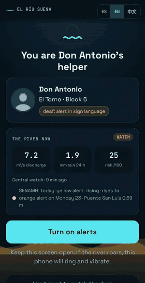 | 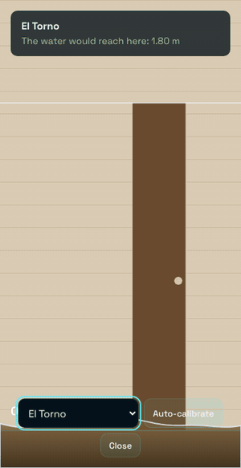 |

<details><summary>📸 Still screenshots</summary>

| Alert | Guardians | Everyone safe |
|---|---|---|
| 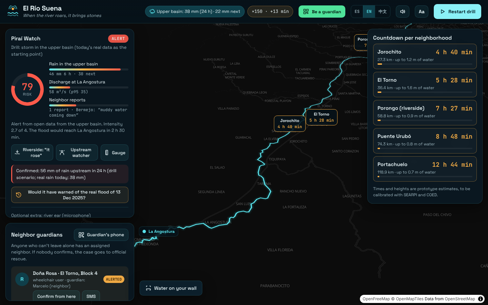 | 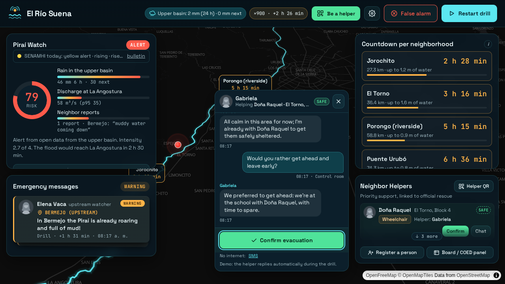 |  |
</details>

### ⚙️ How it works

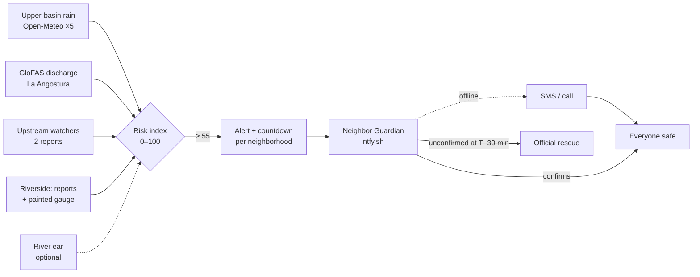

- **Static web, no backend:** published on GitHub Pages and opens on any phone.
- **Map:** MapLibre + OpenFreeMap, with the real Piraí channel taken from OpenStreetMap.
- **Index:** `indiceRiesgo` in `js/datos.js`. Three sources can trigger the alert: rain, discharge and **2 upstream watchers**. Riverside reports alone do **not** trigger it; they only put the area on watch (this avoids false alarms).
- **Audio:** Web Audio with a 4096-sample FFT. It compares the 20–300 Hz energy with the baseline and warns if the rise lasts 1.5 s in a row.
- **Channel to the guardians:** ntfy.sh (pub/sub, also reaches the ntfy app), with BroadcastChannel as a backup.
- **Offline (PWA):** `sw.js` stores the app, the last scan and the map already viewed; it installs from the browser. Guardians have SMS and call as a backup. **The demo doesn’t go down.**
- **Registration and panel:** `js/registro.js`. New people stay pending until the board approves them; CSV with `;` for Spanish-language Excel.
- **Languages:** `js/idioma.js` translates the interface into English and Chinese with the **ES · EN · 中文** buttons, without reloading. Messages to guardians (SMS/ntfy) and the CSV stay in Spanish, the language of the riverbank.
- **Accessibility:** **Aa** button (large text and high contrast) and 🔊 button to read the alert aloud, in the chosen language.

### 📁 Structure
```
index.html        main app (map, index, alert, wall)
guardian.html     phone app (guardian, or neighbor who only watches)
movil.webmanifest phone app install manifest
datos/senamhi.json official SENAMHI bulletin, parsed daily
js/datos.js       neighborhoods, sample guardians, risk index
js/lluvia.js      Watch: Open-Meteo (rain) + GloFAS (discharge)
js/mapa.js        MapLibre + countdown along the channel
js/cauce-pirai.js the Piraí channel (OSM)
js/oido.js        river ear (microphone)
js/pared.js       water on your wall (camera)
js/canal.js       ntfy.sh + BroadcastChannel
js/registro.js    people register, board approval, CSV
js/historico.js   real flood of 12–13 Dec 2025 (open data)
js/idioma.js      interface in Spanish, English and Chinese
sw.js             works offline (PWA)
nodo/             community node: own ntfy, tunnel and Telegram watcher bot with Whisper
herramientas/validar.py  redoes the validation with Open-Meteo
pruebas.mjs       18 tests (index, 2025 flood, times, channel, PWA, CSV, languages)
```

### 🚀 Run it
```bash
python3 -m http.server 8765    # http://localhost:8765/?jurado&lang=en
node pruebas.mjs               # 18 tests ok
python3 herramientas/validar.py  # 2025 flood + 42 years of GloFAS
```
- Camera and microphone need HTTPS or localhost.
- `?x=60` changes the time speed-up (×300 by default in `?jurado`). `?lang=en` or `?lang=zh` opens the interface in that language.

### 🗺️ What’s next
- [ ] Calibrate times and heights with **SEARPI** and **COED**.
- [ ] Test the ntfy channel with 2 real phones and our own ntfy server.
- [ ] Alerts in **LSB (Bolivian Sign Language) video** and audio in **Quechua and Guaraní** recorded by native speakers.
- [x] Registration of people and approval by the neighborhood board.
- [x] Works offline + SMS/call backup.
- [x] Interface in Spanish, English and Chinese.
- [ ] Network of upstream watchers with the board (Bermejo, Espejos river) and a test during the rainy season.
- [ ] High-resolution satellite rain data (GPM IMERG) for local storms.

### 🧭 Honesty
- Distances, speeds and heights are **estimates** until they are calibrated with official data.
- With open data alone, El Río Suena **would not have warned** of the 13 Dec 2025 flood (see *Validation*). The ~4 h head start with watchers is an estimate with a hypothetical report time.
- The system **complements** official stations; it doesn’t replace them. Acoustic detection is a prototype, although acoustic flood monitoring is being studied in research.
- The people in the demo are fictional. The public ntfy topic is only for the demo.

### 👥 Team Birria TECH
Sergio (development) · José Miguel Salinas (pitch, documentation and debugging) · Rodrigo Camacho (testing) · Deron Zuñiga (programming)

**License:** [MIT](LICENSE) · **Data:** Open-Meteo (forecast and Flood API/GloFAS) · © OpenStreetMap contributors · OpenFreeMap.

</details>

## 🇨🇳 中文

<details>
<summary><br><b>▶ 展开完整中文文档</b> · 在本页直接展开，无需刷新</summary>

> **河水作响，必有石来。**

**2025 年 12 月 13 日凌晨，皮拉伊河（Piraí）毫无预警地冲进 El Torno：26 人遇难，居民只能爬上屋顶避险。** “河水作响”（El Río Suena）是一个早期预警系统，为的是不让悲剧重演。它告诉**每个社区洪水到达前还剩多少分钟**，告诉**每位邻居该去接谁**。

<p align="center"></p>

<p align="center">
  <a href="https://neckhurtttt.github.io/el-rio-suena/?jurado&lang=zh"></a>
  
  
  
</p>

#### 一图看懂工作原理

<p align="center">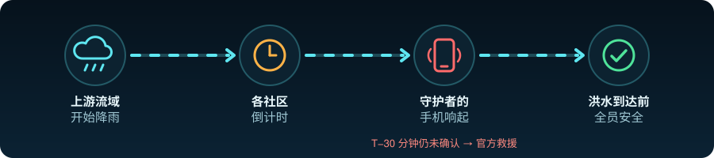</p>

#### 30 秒了解

| | |
|---|---|
| **问题** | 官方警报按颜色等级发布，覆盖整个省。没有一条警报告诉某个街区还有多少时间；无法独自撤离的人只能指望有人记得他们。 |
| **我们做什么** | 在降雨发生的上游流域盯住雨情，并汇总上游观察员的报告，据此计算**各社区倒计时**，并为每位弱势人员指定一位**邻居守护者**。若洪水到达前 30 分钟仍无人确认，则转交官方救援。 |
| **为什么可信** | 我们用真实洪灾做了检验。仅靠开放数据，系统**本来无法预警**，我们如实说明。有两名上游观察员时，预警**约可提前 4 小时**（估算）。警报与确认已在两部真机上跑通。 |
| **成本** | **对家庭免费（0 玻利维亚诺）。** 一个社区的试点约 1,500 玻利维亚诺。**可离线运行**，使用人们已有的手机。 |

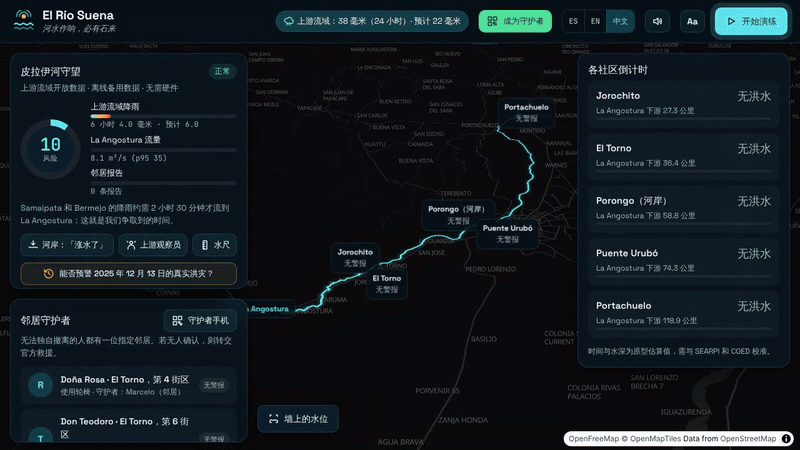

> [!IMPORTANT]
> **我们在寻求：** 本雨季在 El Torno 开展试点，与社区委员会、省政府（COED）和 SEARPI 合作。正式函件已经发出：[`docs/carta-instituciones.md`](docs/carta-instituciones.md)（西班牙语）。

#### 一分钟上手

> [!TIP]
> 1. 打开 **[在线演示](https://neckhurtttt.github.io/el-rio-suena/?jurado&lang=zh)**，点击 **开始演练**。在 `?jurado` 模式下时间加速 300 倍。
> 2. 点击 **成为守护者**，用手机扫描二维码（视频通话中也可以扫）。点击 **开启提醒**。
> 3. 手机响起后，点击 **「我已帮她撤离」**：指挥中心会实时记录你的响应。

顶部的 **ES · EN · 中文** 按钮可直接切换界面语言，无需刷新。**备用视频**（离线可看）：[capturas/zh/demo-respaldo.mp4](capturas/zh/demo-respaldo.mp4)。

由 **Birria TECH** 团队在 Abstracthon 2026 **科技助力**赛道提交，融合了：
- **沟通：** 改变河岸社区获取信息、彼此联系和协同行动的方式：各社区倒计时、邻居报告，以及守护者的一键确认。
- **教育：** 教人们读懂风险：水尺读数（点击 3 次）、画在自家墙上的水位，以及用通俗语言解释的 0–100 风险指数。

---

### 😟 问题
**2025 年 12 月 13 日**凌晨，皮拉伊河在 **El Torno** 决堤：至少 **20 人遇难**、数十人失踪（[France 24/AFP](https://www.france24.com/es/minuto-a-minuto/20251215-al-menos-20-muertos-y-decenas-de-desaparecidos-por-el-desborde-de-un-r%C3%ADo-en-bolivia)），11 个社区约 **600 户家庭受灾**（[El País](https://elpais.bo/nacional/20251217_hay-cerca-de-600-familias-afectadas-en-el-torno.html)），当地宣布进入**省级灾难状态**。这是自 1983 年那场山洪以来 42 年中最大的一次洪灾（[El Deber](https://eldeber.com.bo/santa-cruz/declaran-desastre-riada-historica-pirai-deja-20-muertos_1765881778)、[维基百科](https://es.wikipedia.org/wiki/Turbi%C3%B3n_del_r%C3%ADo_Pira%C3%AD_de_1983)）。几天后，El Torno 市长统计的官方数字为 **26 人遇难，18 个社区至少 1,300 户家庭受灾**（[El Deber，经 eju.tv](https://eju.tv/?p=4852511)）。而且不只是皮拉伊河：2024-25 雨季，降雨使**玻利维亚超过 18.6 万户家庭**受灾，42 人遇难（[El País](https://elpais.bo/nacional/20250313_registran-42-fallecidos-por-las-lluvias-en-bolivia.html)）。随着 2026-27 年厄尔尼诺到来，悲剧可能重演。目前：

- 警报**按颜色等级发布，覆盖整个省**。没有任何一条警报告诉某个具体街区**还剩多少时间**。
- 许多家庭**不撤离，是因为不相信**洪水会淹到自己家。
- 老人、轮椅使用者、听障者和独自在家的孩子，只能指望**有人记得他们**。

### 🎯 为谁设计？
| 对象 | 获得什么 |
|---|---|
| 🏠 **河岸家庭**（El Torno、Jorochito、Porongo、Urubó、Portachuelo） | **自己社区**的倒计时，并能看到洪水**在自家墙上**会涨到多高 |
| ♿ **无法独自撤离的人**：老人、轮椅使用者、听障者、独自在家的孩子、说克丘亚语的人 | 一位指定的**邻居守护者**；若无人确认，则转交官方救援 |
| 🙋 **守护者**（邻居） | 锁屏时也会响铃的警报，**一键**确认（无网络时可用短信或电话） |
| 👀 **上游观察员**（Bermejo、Espejos 河） | 点两下就能报告「河水涨了」；他们能看到卫星看不到的情况 |
| 🏛️ **采用方**：社区委员会、市政府（风险管理单位 UGR）、省政府应急行动中心（COED）、SEARPI | 一个**实时面板**，显示还有谁未确认，可导出 CSV 或打印 |

### 💡 解决方案：4 个部分

| | 部分 | 作用 |
|---|---|---|
| 🛰️ | **皮拉伊河守望** | 每 10 分钟检查上游流域 5 个点的降雨（Open-Meteo）、La Angostura 的 GloFAS 流量，以及**上游观察员**的报告，据此计算 **0 到 100 的风险指数**。三个来源中任意一个都能触发警报（2 名观察员即可）。 此外，每个工作日自动读取 **SENAMHI 官方水文公报**：黄色或橙色预警时进入警戒，红色时直接发出警报，应用永远不会与官方预警相矛盾。 |
| ⏱️ | **各社区倒计时** | 沿真实河道（OSM）测量距离，显示例如「洪水 **2 小时 20 分钟**后到达 El Torno」这样的提示。 |
| 📷 | **墙上的水位** | 用摄像头对准自家房子，应用会画出洪水会涨到多高。没有摄像头时，就画在一面示意墙上。 |
| 🤝 | **邻居守护者** | 每位弱势人员都有一位指定邻居。出现警报时，守护者的手机会响铃并振动，守护者一键确认。**若在洪水到达前 30 分钟仍无人确认，则转交官方救援。** |
| 📱 | **手机应用** | 可从浏览器直接安装（“安装为应用”，无需应用商店），记住每位邻居的社区，离线可用；配合免费的 ntfy 应用，锁屏时也会响铃。任何人都可以只打开它来查看河流。 |

**可选功能：** *河之耳*。放在河岸边的手机监听河水的低频轰鸣（20–300 Hz）。

#### 为什么有效？2 小时 30 分钟的提前量
落在上游流域（Samaipata、Bermejo、Cuevas……）的雨水，大约需要 **2 小时 30 分钟**才流到 La Angostura。只要盯住**下雨的地方**，而不是等河水已经涨起来，就能赢得这段撤离时间。

### 🔬 用 2025 年 12 月 13 日的真实洪灾验证
在信任这个指数之前，我们先用悲剧发生的那一夜来检验它（[`herramientas/validar.py`](herramientas/validar.py)，以及应用中的 **「能否预警真实洪灾？」** 按钮）：

| 开放数据源 | 12 日 06:00 → 13 日 07:00 在皮拉伊河上游流域看到的情况 |
|---|---|
| Open-Meteo best_match | 共 20 毫米，最大 3 毫米/小时 |
| ECMWF IFS | 26 毫米，最大 2 毫米/小时 |
| DWD ICON | 1 毫米 |
| NOAA GFS | 18 毫米，最大 3 毫米/小时 |
| La Angostura 的 GloFAS 流量 | **没有上升**（12 → 12 → 12 m³/s） |

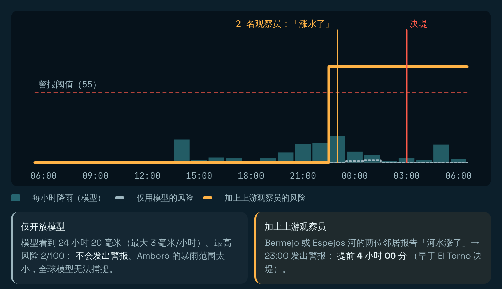

**没有任何全球模型捕捉到 Amboró 的暴雨。** 仅靠开放数据，指数从未超过 **2/100**：“河水作响”**本来无法预警**。我们直说出来，因为它改变了设计：

- 现在，**2 名上游观察员**（Bermejo、Espejos 河）报告「河水涨了」就能**单独触发警报**。按照应用的模型（快速洪水、保守情形），这本可以在 El Torno 决堤前提供**约 4 小时的预警**。*报告时间是假设的：我们不知道邻居会在什么时候看到。*
- 我们还用 **42 年的 GloFAS 数据**（1984–2026：中位数 11 m³/s，p95 35 m³/s）调整了流量阈值。之前用的是 2024–2026 年的数据（p95 17），导致了误报。
- **教训：** 全球模型适用于大范围暴雨；Amboró 的局地暴雨要靠**人**来发现。所以系统结合了开放数据、观察员、水尺和河之耳。

### 🆚 有何不同？
| | **按社区、以分钟**预警 | 能发现**局地**暴雨 | 帮助**无法撤离的人** | **离线** | 家庭费用 |
|---|:---:|:---:|:---:|:---:|:---:|
| 官方颜色警报（省级） | ❌ | 取决于监测站 | ❌ | 广播/电视 | 0 |
| 全球洪水预报（GloFAS、Google Flood Hub） | ❌（按河段） | ❌（见上文） | ❌ | ❌ | 0 |
| 社区 WhatsApp 群 | 有时 | 要看有没有人提醒 | 要看有没有人记得 | ❌ | 0 |
| 警报器 | ❌ | ❌ | ❌（听障者听不到） | ✅ | 高（安装费） |
| **El Río Suena** | ✅ | ✅ 观察员 + 水尺 + 河之耳 | ✅ 守护者 + T−30 转交救援 | ✅ 已安装应用 + 短信 | **0** |

### 🧰 为什么选这些技术？
| 技术 | 原因 |
|---|---|
| **静态网页 + PWA**（GitHub Pages、Service Worker） | 用链接或二维码即可打开，无需应用商店即可安装，并且**可离线运行**。不存在会在洪水中宕机的服务器 |
| **Open-Meteo**（降雨）和 **GloFAS**（流量） | 免费、无需密钥，有历史数据可供验证。适用于大范围暴雨 |
| **观察员 + 水尺** | 弥补模型看不到的情况（2025 年洪灾）。只需要一部普通手机和一点油漆 |
| **ntfy**（开源推送） | 锁屏时也会响，无需注册账号。可以部署在市政府自己的服务器上 |
| **短信 / 电话** | 网络中断时的备用手段，使用手机套餐 |
| **MapLibre + OpenStreetMap** | 开放地图，带有皮拉伊河的真实河道；看过的瓦片会被保存 |
| **Web Audio / 摄像头** | 河之耳和墙上水位都在手机本地运行，不向任何人发送音频或视频 |

### 🏗️ 如何落地
| 阶段 | 内容 | 负责方 | 估算成本 |
|---|---|---|---|
| **0 · 现在** | 可运行的原型，已用 2025 年洪灾验证 | Birria TECH | 0 |
| **1 · 试点**（12 月–3 月雨季） | El Torno：1 个社区委员会、**10 名上游观察员**、桥上 **5 根水尺**、约 50 名登记人员、自建 ntfy 服务器。与 SEARPI 和 COED 校准时间与水深 | 社区委员会 + El Torno UGR + SEARPI | 约 1,500 玻利维亚诺（油漆、4 个月 VPS、培训） |
| **2 · 整条皮拉伊河** | Porongo、圣克鲁斯（河岸）、Urubó、Portachuelo；COED 面板 | 省政府（COED） | 按河段订阅 |
| **3 · 全国** | Río Grande、Mamoré（贝尼）、Rocha（科恰班巴）、拉巴斯的河流：只需更换河道、流域观测点和社区 | 各市政府 + 民防副部 | 同上 |

**对家庭永远免费。** 成本为团队估算，并非报价。

#### 🇧🇴 为什么适用于全国？
- **没有任何部分是皮拉伊河专属的：** 河道、上游 5 个降雨点、社区以及洪水行进时间都是**配置数据**（`js/datos.js`）。换一条河只需更换这些数据；应用、守护者和面板保持不变。
- **开放数据覆盖整个玻利维亚：** Open-Meteo（降雨）和 GloFAS（流量）覆盖全球，无需协议或传感器。
- **人员网络早已遍布全国：** 社区委员会、基层组织（OTB）和市级风险管理单位。“河水作响”为他们提供工具，而不是新建一套组织。
- **边际成本几乎为零：** 每条新河流只需一份配置和约 1,500 玻利维亚诺的试点；推送服务器可以共用。

#### 🗄️ 后端：社区委员会共享名册（Supabase）
- 在**任意手机**上登记的人员会进入其社区的共享名册；指挥中心和委员会**约 2 秒**即可看到（ntfy 通知 + 每 30 秒刷新）。
- 委员会用**密钥**登录面板（演示：社区 `demo`，密钥 `1312`），审批后此人即开始接收警报。每位已审批人员都有一个**守护者二维码**。
- **隐私：** 公开密钥无法读取数据表（RLS 不设任何策略）。所有操作都通过函数（`rs_registrar`、`rs_listar`、`rs_aprobar`、`rs_quitar`）完成，这些函数会校验数据，查看或审批都需要委员会密钥。密钥以 bcrypt 存储。
- **离线时**先保存在手机上，网络恢复后自动发送；指挥中心保留最近一次副本。
- 完整数据库结构：[`supabase/esquema.sql`](supabase/esquema.sql)。已端到端测试：手机登记 → 1.3 秒后出现在指挥中心 → 审批 → 守护者二维码 → 警报 → 0:03 后收到「安全」回复。

### 📈 影响与衡量方式
- **预警时间：** 有观察员时，在 2025 年洪灾中约比决堤早 4 小时（假设）；模型看到降雨时为 **2 小时 30 分钟**。
- **不落下一个人：** 在洪水到达前得到确认的登记人员比例（试点目标：**100%**，其余在 T−30 分钟转交救援）。
- **余量：** 从确认到洪水到达的平均分钟数（「全员安全」页面会计算）。
- **误报：** 每个雨季无洪水的警报次数（试点中与 SEARPI 一起统计）。
- **家庭费用：** 0 玻利维亚诺。
- **守护者真实响应时间：** 指挥中心实时显示（「安全 · 预警后 1:39」）。2026 年 11 月 21 日用 2 部真机测试（安卓 + iPhone）：两部手机都收到警报并回传确认。
- **规模：** 仅 El Torno 一地在 2025 年就有 ≥1,300 户受灾家庭；试点目标是先登记 1 个社区中无法独自撤离的人，再扩展到全部 18 个社区。

### 🎬 1 分钟演示（评委脚本）
1. 打开 `?jurado&lang=zh` → **开始演练**：暴雨降在上游流域。
2. 指数超过 55 → **警报**，每个河岸社区显示各自的倒计时。
3. 守护者手机（二维码）响起 → 点击 **「我已帮她撤离 ✓」**。
4. 所有守护者确认后 → 出现 **「全员安全」** 页面，显示人数、余量和费用。
5. **能否预警 2025 年 12 月 13 日的真实洪灾？** → 那一夜逐小时的图表。
6. **社区委员会 / COED 面板** → 谁还未确认；导出 CSV 或打印。**登记人员** → 委员会审批。
7. 没有 Wi-Fi 时：应用依然能打开（已安装），每个人旁边都能一键给守护者发短信或打电话。

| 📱 守护者的手机响了 | 🧱 墙上的水位上涨 |
|:---:|:---:|
| 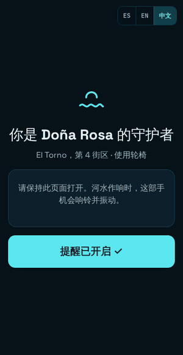 | 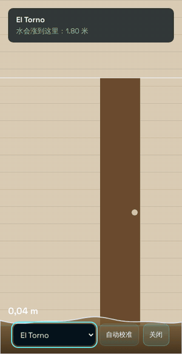 |

<details><summary>📸 静态截图</summary>

| 警报 | 守护者 | 全员安全 |
|---|---|---|
| 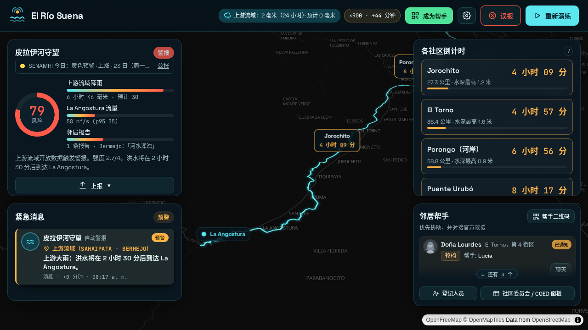 | 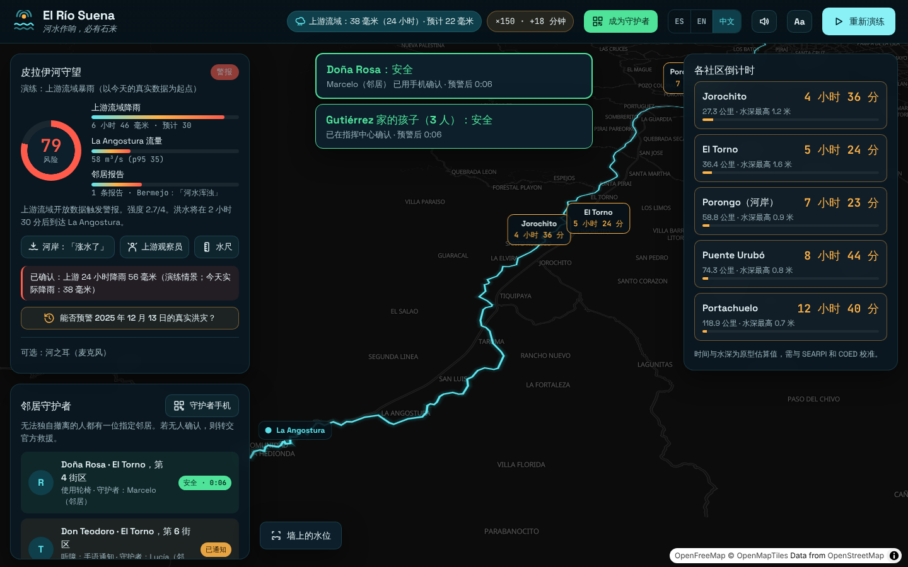 | 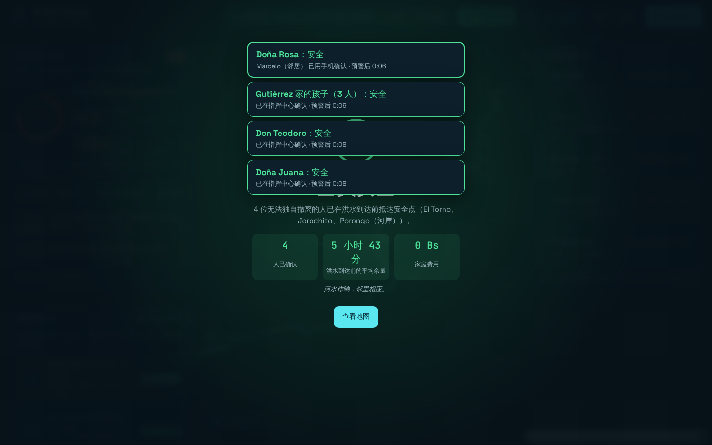 |
</details>

### ⚙️ 工作原理

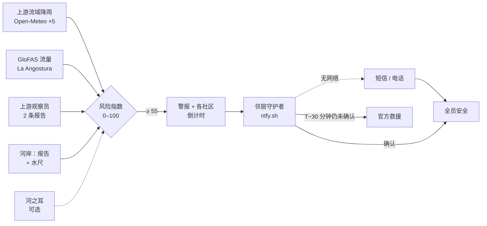

- **静态网页，无后端：** 发布在 GitHub Pages 上，任何手机都能打开。
- **地图：** MapLibre + OpenFreeMap，皮拉伊河的真实河道取自 OpenStreetMap。
- **指数：** `js/datos.js` 中的 `indiceRiesgo`。三个来源可以触发警报：降雨、流量和 **2 名上游观察员**。仅有河岸报告**不会**触发警报，只会让该区域进入关注状态（以避免误报）。
- **音频：** Web Audio，FFT 为 4096 个样本。将 20–300 Hz 的能量与基线比较，若持续升高 1.5 秒即发出提醒。
- **守护者通道：** ntfy.sh（发布/订阅，也会推送到 ntfy 应用），以 BroadcastChannel 作为备用。
- **离线（PWA）：** `sw.js` 保存应用、最近一次扫描和看过的地图；可从浏览器安装。守护者有短信和电话作为备用。**演示不会中断。**
- **登记与面板：** `js/registro.js`。新登记的人员需等委员会审批；CSV 使用 `;` 分隔，方便西班牙语版 Excel 打开。
- **语言：** `js/idioma.js` 通过 **ES · EN · 中文** 按钮把界面翻译成英文和中文，无需刷新。发给守护者的消息（短信/ntfy）和 CSV 保持西班牙语，即河岸居民使用的语言。
- **无障碍：** **Aa** 按钮（大字与高对比度）和 🔊 按钮（用所选语言朗读警报）。

### 📁 目录结构
```
index.html        主应用（地图、指数、警报、墙面）
guardian.html     手机应用（守护者或只看河流的邻居）
movil.webmanifest 手机应用安装清单
datos/senamhi.json 每日解析的 SENAMHI 官方水文公报
js/datos.js       社区、示例守护者、风险指数
js/lluvia.js      守望：Open-Meteo（降雨）+ GloFAS（流量）
js/mapa.js        MapLibre + 沿河道的倒计时
js/cauce-pirai.js 皮拉伊河河道（OSM）
js/oido.js        河之耳（麦克风）
js/pared.js       墙上的水位（摄像头）
js/canal.js       ntfy.sh + BroadcastChannel
js/registro.js    人员登记、委员会审批、CSV
js/historico.js   2025 年 12 月 12–13 日真实洪灾（开放数据）
js/idioma.js      西班牙语、英语、中文界面
sw.js             离线运行（PWA）
nodo/             社区节点：自建 ntfy、隧道，以及基于 Whisper 的 Telegram 观察员机器人
herramientas/validar.py  用 Open-Meteo 重新验证
pruebas.mjs       18 项测试（指数、2025 洪灾、时间、通道、PWA、CSV、语言）
```

### 🚀 运行
```bash
python3 -m http.server 8765    # http://localhost:8765/?jurado&lang=zh
node pruebas.mjs               # 18 项测试通过
python3 herramientas/validar.py  # 2025 年洪灾 + 42 年 GloFAS 数据
```
- 摄像头和麦克风需要 HTTPS 或 localhost。
- `?x=60` 可改变时间加速倍数（`?jurado` 默认 ×300）。`?lang=en` 或 `?lang=zh` 以对应语言打开界面。

### 🗺️ 下一步
- [ ] 与 **SEARPI** 和 **COED** 校准时间与水深。
- [ ] 用 2 部真机和自建 ntfy 服务器测试 ntfy 通道。
- [ ] 提供**玻利维亚手语（LSB）视频**警报，以及由母语者录制的**克丘亚语和瓜拉尼语**音频。
- [x] 人员登记与社区委员会审批。
- [x] 离线运行 + 短信/电话备用。
- [x] 西班牙语、英语、中文界面。
- [ ] 与委员会共建上游观察员网络（Bermejo、Espejos 河），并在雨季测试。
- [ ] 针对局地暴雨引入高分辨率卫星降雨数据（GPM IMERG）。

### 🧭 坦诚说明
- 距离、流速和水深在与官方数据校准之前都是**估算值**。
- 仅靠开放数据，“河水作响”**本来无法预警** 2025 年 12 月 13 日的洪灾（见*验证*）。有观察员时约 4 小时的提前量是基于假设报告时间的估算。
- 本系统**补充**官方监测站，而不是取代它们。声学检测是原型，不过洪水声学监测确实是正在研究的方向。
- 演示中的人物均为虚构。公共 ntfy 主题仅用于演示。

### 👥 Birria TECH 团队
Sergio（开发）· José Miguel Salinas（路演、文档与调试）· Rodrigo Camacho（测试）· Deron Zuñiga（编程）

**许可证：** [MIT](LICENSE) · **数据：** Open-Meteo（预报与 Flood API/GloFAS）· © OpenStreetMap 贡献者 · OpenFreeMap。

</details>

## 🇧🇴 Guaraní

<details>
<summary><br><b>▶ Embojuruja ñe’ẽ guaraníme</b> · ojepe’a ko’ápe voi, ndoikotevẽi ojeguerujey</summary>

> ⚠️ **Borrador para revisión.** Texto inicial escrito por el equipo con apoyo de herramientas, en un guaraní cercano al estándar. Antes de usarlo con la comunidad, debe revisarlo y adaptarlo un hablante de **guaraní boliviano** (ava, simba o isoseño). La interfaz de la app sigue en castellano.

### Mba’épa kóva?
**El Río Suena** (*Ysyry osapukái*) ha’e peteĩ tembiporu omomarandu hag̃ua umi tapicha oikóvape **Piraí ysyry rembe’ýpe**. He’i peteĩteĩ barrio-pe **mboy aravo’ípa hembýve** y og̃uahẽ mboyve, ha he’i peteĩteĩ vecino-pe **máva rehepa oho va’erã**. Omba’apo avei **internet’ỹre**.

### Mba’ére?
2025-pe, jasypakõi 13 pyharevépe, Piraí ysyry osẽ **El Torno**-pe: **26 tapicha omano** ha **1.300 rogaygua** ohasa asy 18 tekohápe. Ko’ág̃a umi ñemomarandu ou color-pe ha opa departamento-pe g̃uarã: avave ndohe’ái peteĩ barrio-pe mboy aravo oguerekópa.

### Mba’épa ojapo?
1. **Omaña ama oky hápe**, ysyry yvate gotyo: upe ama og̃uahẽ La Angostura-pe **2 aravo 30 aravo’i** rire. Upéva ha’e pe ára jajeguerekóva jasẽ hag̃ua.
2. **Ombohasa peteĩteĩ barrio-pe** mboy aravo’ípa hembýve: «y og̃uahẽta El Torno-pe 2 aravo 20 aravo’ípe».
3. **Ohechauka nde óga korapýpe** mamo pevépa y ojupíta.
4. **Ñangarekoha vecino:** umi tapicha ndaikatúiva osẽ ijehegui oguereko peteĩ vecino ombohapéva. Ipumbyry osapukái, ha ojopy peteĩ jey «aipytyvõma». Avave ndohechaukáiramo 30 aravo’i y og̃uahẽ mboyve, ohasa **rescate oficial**-pe.

### Mba’éichapa ojeporu (demo)
1. Eipe’a https://neckhurtttt.github.io/el-rio-suena/?jurado ha ejopy **Iniciar simulacro**.
2. Ehecha mboy aravo’ípa hembýve peteĩteĩ barrio-pe.
3. Pumbyry ñangarekoha mba’e osapukái → ejopy **«Ya la ayudé ✓»**.
4. Opavave oĩma porã rire → **«Todos a salvo»**.


### Añetegua
Umi aravo ha y ijyvatekue ojekuaa’ỹmi gueteri; oñemohenda va’erã **SEARPI** ha **COED** ndive. Ko tembiporu oipytyvõ umi ñemomarandu oficial-pe, nombyekovia’i chupekuéra. Ñe’ẽ guaraníme oñembohasa va’erã guaraní ñe’ẽhára ndive.

</details>

## 🇧🇴 Runasimi (quechua)

<details>
<summary><br><b>▶ Runasimipi qillqata kichay</b> · kaypi kichakun, mana watiqmanta kargakunchu</summary>

> ⚠️ **Borrador para revisión.** Texto inicial escrito por el equipo con apoyo de herramientas. Antes de usarlo con la comunidad, debe revisarlo y adaptarlo un hablante de **quechua del sur de Bolivia** (qhichwa). La interfaz de la app sigue en castellano; los audios en quechua se grabarán con hablantes (ver *Lo que sigue*).

### Imataq kay?
**El Río Suena** (*Mayu qhaparin*) nisqaqa **Piraí mayu patapi** tiyaq runakunata willanapaq. Sapa barriota willan **hayk’a minutullaña** unu chayamunankama, sapa vecinotataq willan **pita pusamunanta**. **Internet mana kaqtinpas** llamk’an.

### Imarayku?
2025 watapi, diciembre killaq 13 p’unchawninpi, tutamanta, Piraí mayu **El Tornopi** lluqsirqa: **26 runakuna wañurqanku**, 18 llaqtakunapitaq **1.300 familiakuna** ñak’arirqanku. Kunanqa willakuykuna colorkunallawan, tukuy departamentopaq hamun: manan pipas sapa barriota willanchu hayk’a pachallaña kasqanta.

### Imatataq ruwan?
1. **Para urmasqanta qhawan** mayu wichaypi: chay paraqa La Angosturaman **2 hora 30 minutupi** chayan. Chay pachallataq ayqinapaq kanchik.
2. **Sapa barriopaq minutukunata yupan:** «unuqa El Tornoman 2 hora 20 minutupi chayamunqa».
3. **Wasiykiq perqanpi rikuchin** unu hayk’akama wicharinanta.
4. **Amachaq vecino:** mana sapallan lluqsiyta atiq runaqa huk vecinoyuq. Celularnin waqan, huk ñit’iyllawan «yanapaniña» nin. Mana pipas willaqtinqa, unu chayamunanmanta 30 minutu ñawpaqta, **rescate oficialman** pasan.

### Imaynata llamk’achina (demo)
1. https://neckhurtttt.github.io/el-rio-suena/?jurado kichay, **Iniciar simulacro** ñit’iy.
2. Sapa barriopaq minutukunata qhaway.
3. Amachaqpa celularnin waqan → **«Ya la ayudé ✓»** ñit’iy.
4. Llapanku allinña kaqtinku → **«Todos a salvo»**.


### Sut’inta
Pachakuna, unuq hatun kayninpas yuyaychasqallaraq kanku; **SEARPI**, **COED**-wan allinchanayku tiyan. Kay llamk’anaqa oficial willakuykunata yanapan, manan paykunaq rantinchu. Runasimipi willakuykunataqa runasimi rimaqkunawan ruwasaqku.

</details>

## 🇧🇴 Ayoreo

<details>
<summary><b>▶ Ayoreo: sección en preparación con hablantes</b> · Ayoreo: section being prepared with native speakers</summary>

> **¿Por qué esta sección no tiene todavía texto en ayoreo?** El ayoreo es una lengua de la familia zamuco que hablan unas pocas miles de personas en Bolivia y Paraguay. No hay herramientas ni materiales que permitan traducirlo con fiabilidad, y publicar un texto inventado sería engañoso e irrespetuoso con el pueblo ayoreo. Esta sección se completará **junto a hablantes ayoreo**, por ejemplo con apoyo de la Central Ayorea Nativa del Oriente Boliviano (CANOB), y se grabará también en audio.
>
> *Ayoreo is a Zamucoan language spoken by a few thousand people in Bolivia and Paraguay. There are no reliable tools to translate it, so instead of publishing an invented text, this section will be written together with Ayoreo speakers.*

**Texto base para la persona que traduzca** (castellano en lectura fácil, frases cortas):

1. El Río Suena avisa cuando el río Piraí va a crecer.
2. Te dice cuántos minutos faltan para que el agua llegue a tu barrio.
3. Muestra en la pared de tu casa hasta dónde subiría el agua.
4. Cada persona que no puede salir sola tiene un vecino que la ayuda.
5. El celular del vecino suena. El vecino la lleva al lugar seguro y toca «Ya la ayudé».
6. Si nadie responde, va el rescate oficial.
7. Funciona sin internet. Es gratis para las familias.

**Cómo aportar la traducción:** abrir un *issue* o un *pull request* con el texto en ayoreo de los 7 puntos y el nombre de la persona o comunidad que tradujo, para darle el crédito.

</details>
