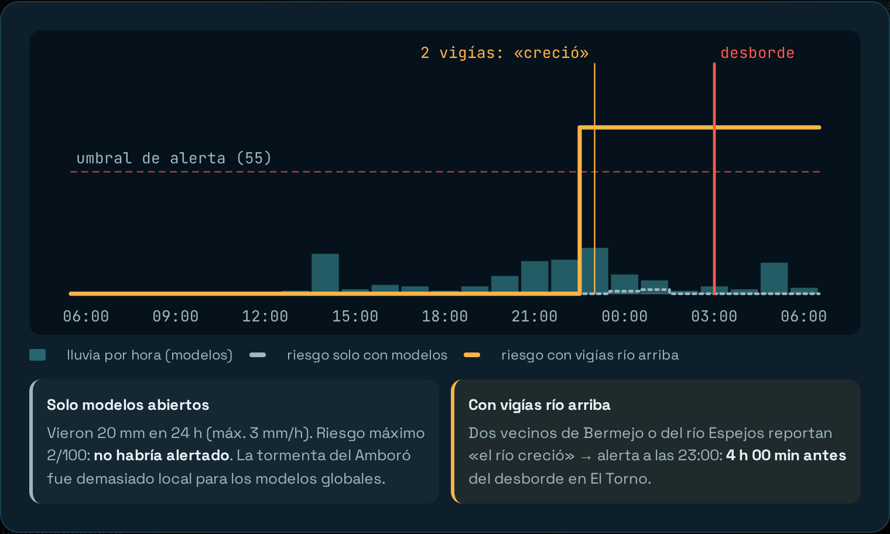
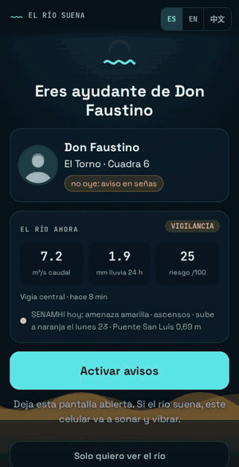
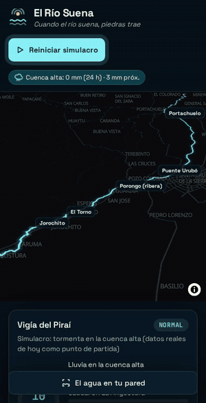
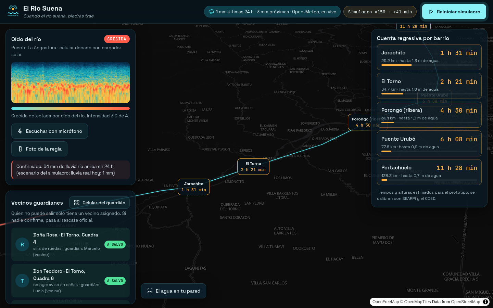
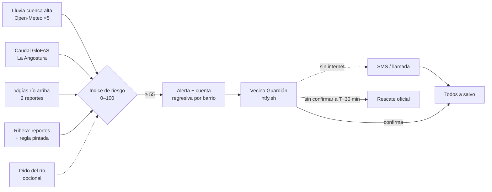

<p align="center"></p>

# 🌊 El Río Suena

> **Cuando el río suena, piedras trae.**
> **La propuesta:** que ninguna familia de la ribera del Piraí se entere de la crecida cuando el agua ya está en la puerta. El Río Suena le dice a **cada barrio cuántos minutos le quedan** y a **cada vecino a quién tiene que ir a buscar**. Usa datos abiertos, vigías río arriba y celulares que ya existen, y **funciona sin internet**.

<p align="center">
  <a href="https://neckhurtttt.github.io/el-rio-suena/?jurado"></a>
  
  
  
</p>
<p align="center">
  
  
  
  
  
  
</p>
<p align="center"><b>🇧🇴 Español</b> · <a href="#-english">🇬🇧 English</a> · <a href="#-中文">🇨🇳 中文</a> · 🎤 <a href="pitch-el-rio-suena.md">Guion del pitch</a> · 📊 <a href="El%20R%C3%ADo%20Suena%20%C2%B7%20Pitch.pptx">Presentación</a></p>


**▶ Demo en vivo:** https://neckhurtttt.github.io/el-rio-suena/?jurado. Tocar **Iniciar simulacro**: en `?jurado` el tiempo corre ×300.
**📱 Celular del guardián:** botón «Celular del guardián» → escanear el QR (`guardian.html?t=<tema>&p=rosa`).

Abstracthon 2026 · Equipo **Birria TECH** · Track **Ayuda Tecnológica**, que exige mezclar dos o más tracks. El proyecto vive en el cruce de:
- **Comunicación:** cambia la forma en que un barrio de la ribera se informa, se conecta y se coordina. Tiene la cuenta regresiva por barrio, los reportes de vecinos y el Vecino Guardián, que confirma con un toque.
- **Educación:** enseña a leer el riesgo con la regla pintada (lectura en 3 toques), el agua en tu pared y el índice 0–100 explicado en palabras simples.

🎥 **Video de respaldo (sin internet):** [capturas/demo-respaldo.mp4](capturas/demo-respaldo.mp4) · también en la [release v1.0-abstracthon](https://github.com/NeckHurtttt/el-rio-suena/releases/tag/v1.0-abstracthon).

---

## 😟 Problema
La madrugada del **13 de diciembre de 2025** el Piraí se desbordó en **El Torno**: al menos **20 fallecidos** y decenas de desaparecidos ([France 24/AFP](https://www.france24.com/es/minuto-a-minuto/20251215-al-menos-20-muertos-y-decenas-de-desaparecidos-por-el-desborde-de-un-r%C3%ADo-en-bolivia)), cerca de **600 familias afectadas** en 11 comunidades ([El País](https://elpais.bo/nacional/20251217_hay-cerca-de-600-familias-afectadas-en-el-torno.html)) y declaratoria de **desastre departamental**. Fue la riada más grande en 42 años, desde el turbión de 1983 ([El Deber](https://eldeber.com.bo/santa-cruz/declaran-desastre-riada-historica-pirai-deja-20-muertos_1765881778), [Wikipedia](https://es.wikipedia.org/wiki/Turbi%C3%B3n_del_r%C3%ADo_Pira%C3%AD_de_1983)). Días después, el alcalde de El Torno contaba **26 fallecidos oficiales y al menos 1.300 familias damnificadas en 18 comunidades** ([El Deber vía eju.tv](https://eju.tv/?p=4852511)). Y no es solo el Piraí: en la temporada 2024-25 las lluvias afectaron a **más de 186.000 familias en Bolivia** y dejaron 42 fallecidos ([El País](https://elpais.bo/nacional/20250313_registran-42-fallecidos-por-las-lluvias-en-bolivia.html)). Con El Niño 2026-27 puede repetirse. Hoy:

- Las alertas se dan **por colores y para todo el departamento**. Ninguna le dice a una cuadra concreta **cuánto tiempo le queda**.
- Muchas familias **no evacúan porque no creen** que el agua vaya a llegar a su casa.
- Los adultos mayores, las personas en silla de ruedas, las personas sordas y los niños solos dependen de que **alguien se acuerde de ellos**.

## 🎯 ¿Para quién es?
| Quién | Qué gana |
|---|---|
| 🏠 **Familias de la ribera** (El Torno, Jorochito, Porongo, Urubó, Portachuelo) | Una cuenta regresiva para **su** barrio y ver el agua **en su propia pared** |
| ♿ **Quien no puede evacuar solo**: adultos mayores, personas en silla de ruedas o sordas, niños solos, hablantes de quechua | Un **vecino guardián** asignado; si nadie confirma, pasa al rescate oficial |
| 🙋 **Guardianes** (vecinos) | Un aviso que suena con la pantalla apagada y se confirma con **un toque** (o SMS/llamada sin internet) |
| 👀 **Vigías río arriba** (Bermejo, río Espejos) | Dos toques para avisar «el río creció»; ven lo que los satélites no ven |
| 🏛️ **Quien lo adopta**: junta vecinal, municipio (UGR), COED de la Gobernación, SEARPI | Un **panel en vivo** de quién falta, exportable a CSV o impreso |

## 💡 Solución en 4 piezas

| | Pieza | Qué hace |
|---|---|---|
| 🛰️ | **Vigía del Piraí** | Cada 10 min revisa la lluvia en 5 puntos de la cuenca alta (Open-Meteo), el caudal GloFAS en La Angostura y los reportes de **vigías río arriba**. Con eso calcula un **índice de riesgo de 0 a 100**. Cualquiera de las tres fuentes puede disparar la alerta (2 vigías bastan). |
| ⏱️ | **Cuenta regresiva por barrio** | Mide la distancia sobre el cauce real del río (OSM) y muestra avisos como «el agua llega a El Torno en **2 h 20 min**». |
| 📷 | **El agua en tu pared** | Apuntas la cámara a tu casa y la app dibuja hasta dónde subiría el agua. Si no hay cámara, la muestra sobre una pared dibujada. |
| 🤝 | **Vecino Guardián** | Cada persona vulnerable tiene un vecino asignado. Cuando hay alerta, el celular del guardián suena y vibra, y el guardián confirma con un toque. **Si nadie confirma 30 min antes de que llegue el agua, el caso pasa al rescate oficial.** |

**Extra opcional:** el *oído del río*. Un celular junto a la orilla escucha el rugido grave del agua (20–300 Hz).

### ¿Por qué funciona? La ventaja de 2 h 30 min
La lluvia que cae en la cuenca alta (Samaipata, Bermejo, Cuevas…) tarda unas **2 h 30 min** en bajar hasta La Angostura. Si se mira **donde llueve** y no donde ya creció el río, se gana ese tiempo para evacuar.

## 🔬 Validación con la riada real del 13/12/2025
Antes de confiar en el índice, lo probamos con la noche de la tragedia ([`herramientas/validar.py`](herramientas/validar.py), botón **«¿Habría avisado la riada real?»** en la app):

| Fuente abierta | Lo que vio en la cuenca alta del Piraí, 12/12 06:00 → 13/12 07:00 |
|---|---|
| Open-Meteo best_match | 20 mm en total, máximo 3 mm/h |
| ECMWF IFS | 26 mm, máximo 2 mm/h |
| DWD ICON | 1 mm |
| NOAA GFS | 18 mm, máximo 3 mm/h |
| Caudal GloFAS en La Angostura | **no subió** (12 → 12 → 12 m³/s) |



**Ningún modelo global vio la tormenta del Amboró.** Con solo datos abiertos, el índice no pasa de **2/100**: El Río Suena **no habría avisado**. Lo decimos claro porque cambió el diseño:

- Ahora **2 vigías río arriba** (Bermejo, río Espejos) que reporten «el río creció» **disparan la alerta solos**. Con el modelo de la app (crecida rápida, caso conservador), eso habría dado **~4 h de aviso** antes del desborde en El Torno. *La hora del reporte es hipotética: no sabemos cuándo lo habría visto un vecino.*
- También ajustamos el umbral del caudal con **42 años de GloFAS** (1984–2026: mediana 11 m³/s, p95 35 m³/s). Antes usábamos 2024–2026 (p95 17), y eso daba falsas alarmas.
- **Lección:** los modelos globales sirven para tormentas grandes; las tormentas locales del Amboró las ven **las personas**. Por eso el sistema mezcla datos abiertos, vigías, reglas pintadas y el oído del río.

## 🆚 ¿En qué se diferencia?
| | Aviso **por barrio con minutos** | Ve tormentas **locales** | Ayuda a **quien no puede salir** | **Sin internet** | Costo para la familia |
|---|:---:|:---:|:---:|:---:|:---:|
| Alerta oficial por colores (departamental) | ❌ | depende de estaciones | ❌ | radio/TV | 0 |
| Pronósticos globales de crecidas (GloFAS, Google Flood Hub) | ❌ (por tramo de río) | ❌ (ver arriba) | ❌ | ❌ | 0 |
| Grupos de WhatsApp del barrio | a veces | si alguien avisa | si alguien se acuerda | ❌ | 0 |
| Sirenas | ❌ | ❌ | ❌ (no oyen las personas sordas) | ✅ | alto (instalación) |
| **El Río Suena** | ✅ | ✅ vigías + regla + oído | ✅ guardián + rescate a T−30 | ✅ app guardada + SMS | **0** |

## 🧰 ¿Por qué estas tecnologías?
| Tecnología | Por qué |
|---|---|
| **Web estática + PWA** (GitHub Pages, service worker) | Se abre con un link o QR, se instala sin tienda de apps y **funciona sin internet**. No hay servidor que se caiga en plena crecida |
| **Open-Meteo** (lluvia) y **GloFAS** (caudal) | Gratis, sin clave, con historia para validar. Sirven para tormentas grandes |
| **Vigías + regla pintada** | Cubren lo que los modelos no ven (riada 2025). Solo necesitan un celular básico y pintura |
| **ntfy** (push abierto) | Suena con la pantalla apagada y no hace falta crear cuentas. Se puede instalar en un servidor propio del municipio |
| **SMS / llamada** | Respaldo cuando cae el internet; usa el plan del celular |
| **MapLibre + OpenStreetMap** | Mapa abierto con el cauce real del Piraí; las teselas vistas quedan guardadas |
| **Web Audio / cámara** | El oído del río y el agua en tu pared corren en el celular, sin enviar audio ni video a nadie |

## 🏗️ Cómo se implementa
| Fase | Qué | Quién | Costo estimado |
|---|---|---|---|
| **0 · Hoy** | Prototipo funcionando, validado con la riada 2025 | Birria TECH | 0 |
| **1 · Piloto** (temporada de lluvias dic–mar) | El Torno: 1 junta vecinal, **10 vigías** río arriba, **5 reglas pintadas** en puentes, ~50 personas registradas, servidor ntfy propio. Calibrar tiempos y alturas con SEARPI y COED | Junta vecinal + UGR El Torno + SEARPI | ≈ Bs 1.500 (pintura, VPS por 4 meses, capacitación) |
| **2 · Todo el Piraí** | Porongo, Santa Cruz (ribera), Urubó, Portachuelo; panel del COED | Gobernación (COED) | suscripción por tramo de río |
| **3 · Nivel nacional** | Río Grande, Mamoré (Beni), Rocha (Cochabamba), ríos de La Paz: solo se cambia el cauce, los puntos de la cuenca y los barrios | Municipios + Viceministerio de Defensa Civil | igual |

**Siempre gratis para las familias.** Los costos son estimaciones del equipo y no cotizaciones.

### 🇧🇴 ¿Por qué sirve para todo el país?
- **Nada es propio del Piraí:** el cauce, los 5 puntos de lluvia de la cuenca alta, los barrios y el tiempo de viaje del agua son **datos de configuración** (`js/datos.js`). Para otro río se cambian esos datos; la app, los guardianes y el panel son los mismos.
- **Los datos abiertos cubren toda Bolivia:** Open-Meteo (lluvia) y GloFAS (caudal) tienen cobertura mundial, sin convenios ni sensores.
- **La red humana ya existe en todo el país:** juntas vecinales, OTB y Unidades de Gestión de Riesgo municipales. El Río Suena les da una herramienta, no crea una estructura nueva.
- **Costo marginal casi cero:** cada río nuevo es una configuración + un piloto de ≈Bs 1.500; el servidor de avisos es el mismo.

### 🗄️ Backend: registro compartido de la junta (Supabase)
- Quien registra a una persona desde **cualquier celular** la manda al registro compartido de su comunidad; la central y la junta la ven **en ~2 s** (aviso por ntfy + refresco cada 30 s).
- La junta entra al panel con su **clave** (demo: comunidad `demo`, clave `1312`), aprueba y desde ese momento la persona recibe alertas. Cada persona aprobada tiene su **QR de guardián**.
- **Privacidad:** las tablas no se pueden leer con la clave pública (RLS sin políticas). Todo pasa por funciones (`rs_registrar`, `rs_listar`, `rs_aprobar`, `rs_quitar`) que validan los datos y exigen la clave de la junta para ver o aprobar. Clave guardada con bcrypt.
- **Sin internet** se guarda en el celular y se envía solo al volver la conexión; la central conserva la última copia.
- Esquema completo: [`supabase/esquema.sql`](supabase/esquema.sql). Probado de punta a punta: registro en celular → aparece en la central en 1,3 s → aprobación → QR del guardián → alerta → «a salvo» de vuelta en 0:03.

## 📈 Impacto y cómo lo medimos
- **Tiempo de aviso:** ~4 h antes del desborde en la riada 2025 con vigías (hipotético); **2 h 30 min** con lluvia vista por los modelos.
- **Nadie olvidado:** % de personas registradas confirmadas antes del agua (meta del piloto: **100 %**, el resto pasa al rescate a T−30 min).
- **Margen:** minutos promedio entre la confirmación y la llegada del agua (la pantalla «Todos a salvo» lo calcula).
- **Falsas alarmas:** alertas sin crecida por temporada (se cuentan en el piloto con SEARPI).
- **Costo para la familia:** 0 Bs.
- **Tiempo real de respuesta del guardián:** la central lo muestra en vivo («a salvo · 1:39 tras el aviso»). Prueba del 21/11/2026 con 2 celulares reales (Android + iPhone): ambos recibieron la alerta y confirmaron de vuelta.
- **Escala:** El Torno sola tuvo ≥1.300 familias damnificadas en 2025; la meta del piloto es registrar a las personas que no pueden salir solas de 1 comunidad y luego extender a las 18.

## 🎬 Demo en 1 minuto (guion para el jurado)
1. Abrir `?jurado` → **Iniciar simulacro**: cae una tormenta en la cuenca alta.
2. El índice supera 55 → **ALERTA**, y cada barrio de la ribera muestra su cuenta regresiva.
3. El celular del guardián (QR) suena → toca **«Ya la ayudé ✓»**.
4. Cuando todos los guardianes confirman → pantalla **«Todos a salvo»** con las personas, el margen y el costo.
5. **¿Habría avisado la riada real del 13/12/2025?** → la gráfica de esa noche, hora por hora.
6. **Panel de la junta / COED** → quién falta; exportar CSV o imprimir. **Registrar persona** → la junta aprueba.
7. Sin wifi: la app abre igual (ya instalada) y desde cada persona sale un SMS o una llamada al guardián con un toque.

| 📱 El celular del guardián suena | 🧱 El agua sube en tu pared |
|:---:|:---:|
|  |  |

<details><summary>📸 Capturas fijas</summary>

| Alerta | Guardianes | Todos a salvo |
|---|---|---|
|  |  |  |
</details>

## ⚙️ Cómo funciona



- **Web estática, sin backend:** se publica en GitHub Pages y abre en cualquier celular.
- **Mapa:** MapLibre + OpenFreeMap, con el cauce real del Piraí sacado de OpenStreetMap.
- **Índice:** `indiceRiesgo` en `js/datos.js`. Tres fuentes pueden disparar la alerta: lluvia, caudal y **2 vigías río arriba**. Los reportes de la ribera solos **no** alertan, solo dejan la zona en vigilancia (así se evitan las falsas alarmas).
- **Audio:** Web Audio con una FFT de 4096 muestras. Compara la energía entre 20 y 300 Hz con la línea base y avisa si la subida dura 1,5 s seguidos.
- **Canal a los guardianes:** ntfy.sh (pub/sub, también llega a la app ntfy), con BroadcastChannel como respaldo.
- **Sin internet (PWA):** `sw.js` guarda la app, el último escaneo y el mapa ya visto; se instala desde el navegador. Los guardianes tienen SMS y llamada de respaldo. **La demo no se cae.**
- **Registro y panel:** `js/registro.js`. Las personas nuevas quedan pendientes hasta que la junta las aprueba; CSV con `;` para Excel en español.
- **Accesibilidad:** botón **Aa** (letra grande y alto contraste) y botón 🔊 para leer el aviso en voz alta.

## 📁 Estructura
```
index.html        app principal (mapa, índice, alerta, pared)
guardian.html     pantalla del celular del guardián
js/datos.js       barrios, guardianes de ejemplo, índice de riesgo
js/lluvia.js      Vigía: Open-Meteo (lluvia) + GloFAS (caudal)
js/mapa.js        MapLibre + cuenta regresiva sobre el cauce
js/cauce-pirai.js cauce del Piraí (OSM)
js/oido.js        oído del río (micrófono)
js/pared.js       el agua en tu pared (cámara)
js/canal.js       ntfy.sh + BroadcastChannel
js/registro.js    registro de personas, aprobación de la junta, CSV
js/historico.js   riada real 12–13/12/2025 (datos abiertos)
sw.js             funciona sin internet (PWA)
herramientas/validar.py  rehace la validación con Open-Meteo
pruebas.mjs       15 pruebas (índice, riada 2025, tiempos, canal, PWA, CSV)
```

## 🚀 Correrlo
```bash
python3 -m http.server 8765    # http://localhost:8765/?jurado
node pruebas.mjs               # 15 pruebas ok
python3 herramientas/validar.py  # riada 2025 + 42 años de GloFAS
```
- La cámara y el micrófono necesitan HTTPS o localhost.
- `?x=60` cambia la aceleración del tiempo (por defecto ×300 en `?jurado`).

## 🗺️ Lo que sigue
- [ ] Calibrar tiempos y alturas con **SEARPI** y el **COED**.
- [ ] Probar el canal ntfy con 2 celulares reales y un servidor ntfy propio.
- [ ] Avisos en **video LSB** y audios en **quechua y guaraní** grabados por hablantes.
- [x] Registro de personas y aprobación de la junta vecinal (en el navegador; falta base compartida).
- [x] Funciona sin internet + SMS/llamada de respaldo.
- [ ] Red de vigías río arriba con la junta (Bermejo, río Espejos) y prueba en temporada de lluvias.
- [ ] Datos de lluvia satelital de alta resolución (GPM IMERG) para tormentas locales.

## 🧭 Honestidad
- Las distancias, las velocidades y las alturas son **estimadas** hasta que se calibren con datos oficiales.
- Con solo datos abiertos, El Río Suena **no habría avisado** la riada del 13/12/2025 (ver *Validación*). La ventaja de ~4 h con vigías es una estimación con una hora de reporte hipotética.
- El sistema **complementa** a las estaciones oficiales; no las reemplaza. La detección acústica es un prototipo, aunque el monitoreo acústico de crecidas sí se estudia en investigación.
- Las personas de la demo son ficticias. El tema público de ntfy sirve solo para la demo.

## 👥 Equipo Birria TECH
Sergio (desarrollo) · José Miguel Salinas (pitch, documentación y depuración) · Rodrigo Camacho (tester) · Deron Zuñiga (programación)

**Licencia:** [MIT](LICENSE) · **Datos:** Open-Meteo (pronóstico y Flood API/GloFAS) · © colaboradores de OpenStreetMap · OpenFreeMap.

---

## 🇬🇧 English
**When the river roars, it brings stones.** Early flood warning for the Piraí river (Santa Cruz, Bolivia), neighborhood by neighborhood, for people who can't evacuate alone. It needs no hardware.

- **Piraí Watch:** every 10 min it reads open data: rain at 5 upper-basin points (Open-Meteo), GloFAS discharge at La Angostura and neighbor reports. With that it computes a **0–100 risk index**. Rain in the upper basin takes about **2 h 30 min** to reach La Angostura, and that is the head start for evacuating.
- **Countdown per neighborhood**, measured along the real river channel: *"water reaches El Torno in 2 h 20 min"*.
- **Water on your wall:** point the camera at your house and see how high the water would rise.
- **Neighbor Guardian:** the guardian's phone rings and vibrates, and they confirm with one tap. If nobody confirms 30 min before the water arrives, the case goes to official rescue.
- **Optional extra:** a phone that *listens* to the river's low rumble (20–300 Hz).

**Validated against the real flood of 13 Dec 2025** (El Torno: 26 dead, 1,300+ families affected in 18 communities): no open model saw the local Amboró storm (≤ 26 mm, GloFAS flat), so open data alone would **not** have warned. Now **2 upstream watchers** trigger the alert alone, which would have given ~4 h of warning (hypothetical report time). Works **offline** (PWA) with SMS/call fallback, has a **neighborhood-board panel** (CSV/print), registration with approval, and a large-text/high-contrast mode.

- **Backend (Supabase):** a person registered from **any phone** shows up on the board's panel in **~1.3 s**. The board signs in with its key (demo: community `demo`, key `1312`), approves people, and gets a **guardian QR code** for each one. The tables cannot be read with the public key: everything goes through RPC functions that validate the data and require the board's key. Offline sign-ups are queued and sent later. Schema: `supabase/esquema.sql`.
- **Tested on real phones (21 Nov 2026):** an Android and an iPhone got the alert with a siren and replied "safe". The central shows the real response time live ("safe · 0:03 after the alert"). Judges can join from the video call by scanning the **«Sé guardián»** QR code.
- **Nationwide:** rain affected **186,000+ families in Bolivia** in the 2024-25 season. The river, basin points and neighborhoods are configuration, so the same app works for the Mamoré (Beni), the Rocha (Cochabamba) or the rivers of La Paz. Open-Meteo and GloFAS cover the whole country, and every municipality already has neighborhood boards. Each new river is a pilot of about Bs 1,500.

Tracks: **Technology Aid** = **Communication** (neighborhood alerts, reports, guardians) + **Education** (painted gauge, water on your wall, plain-language risk index). Backup video: `capturas/demo-respaldo.mp4`. License: MIT.

Demo: open `?jurado` → **Iniciar simulacro**. Run locally: `python3 -m http.server 8765`, tests: `node pruebas.mjs`. Distances and heights are estimates until they are calibrated with SEARPI/COED. This complements official stations; it does not replace them.

## 🇨🇳 中文
**河水作响，必有石来。** 面向玻利维亚圣克鲁斯皮拉伊河沿岸的洪水预警系统：按社区倒计时，为无法独自撤离的人安排邻居守护者，无需任何硬件。

- **皮拉伊河守望**：每 10 分钟读取开放数据，包括上游流域 5 个点的降雨量（Open-Meteo）、La Angostura 的 GloFAS 流量和邻居上报，计算 **0–100 风险指数**。上游降雨约 **2 小时 30 分钟** 后到达 La Angostura，这就是争取到的撤离时间。
- **按社区倒计时**：沿真实河道计算，例如「洪水 2 小时 20 分钟后到达 El Torno」。
- **墙上的水位**：用手机摄像头对准自家墙面，显示水会涨到多高。
- **邻居守护者**：守护者的手机响铃并震动，一键确认；若洪水到达前 30 分钟仍无人确认，则转交官方救援。

**已用 2025 年 12 月 13 日真实洪灾验证**（El Torno：26 人遇难，18 个社区逾 1,300 户受灾）：开放模型都没有捕捉到 Amboró 局地暴雨，仅靠开放数据**无法**预警；因此现在 **2 名上游观察员** 即可单独触发警报（约提前 4 小时，报告时间为假设）。支持**离线**（PWA）与短信/电话备份、社区委员会面板（CSV/打印）、登记审批及大字高对比模式。

- **后端（Supabase）**：在**任意手机**上登记的人约 **1.3 秒** 后出现在社区委员会面板上。委员会用密钥登录（演示：社区 `demo`，密钥 `1312`），审批后为每个人生成**守护者二维码**。公开密钥无法直接读取数据表，所有操作都通过校验数据并要求委员会密钥的 RPC 函数完成；离线登记会排队，联网后自动上传。数据库结构：`supabase/esquema.sql`。
- **真机测试（2026 年 11 月 21 日）**：一部安卓手机和一部 iPhone 收到带警报声的预警并回复「安全」；中心实时显示真实响应时间（「安全 · 预警后 0:03」）。评委在视频会议中扫描 **«Sé guardián»** 二维码即可加入。
- **全国适用**：2024-25 雨季，玻利维亚有**超过 18.6 万户**家庭受灾。河道、流域观测点和社区都只是配置，同一套系统可用于 Mamoré（贝尼）、Rocha（科恰班巴）或拉巴斯的河流；Open-Meteo 与 GloFAS 覆盖全国，各市已有社区委员会。每条新河流的试点成本约 1,500 玻利维亚诺。

赛道：**科技助力** = **沟通**（社区预警、邻居上报、守护者）+ **教育**（水尺读数、墙上水位、通俗风险指数）。备用视频：`capturas/demo-respaldo.mp4`。许可证：MIT。

演示：打开 `?jurado` → 点击 **Iniciar simulacro**。本地运行：`python3 -m http.server 8765`，测试：`node pruebas.mjs`。距离与水位均为估算，需要与 SEARPI/COED 校准；本系统是官方监测站的补充，不能替代它们。

