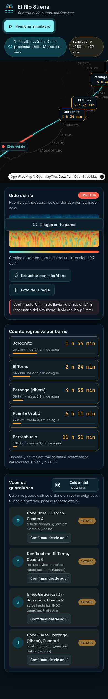
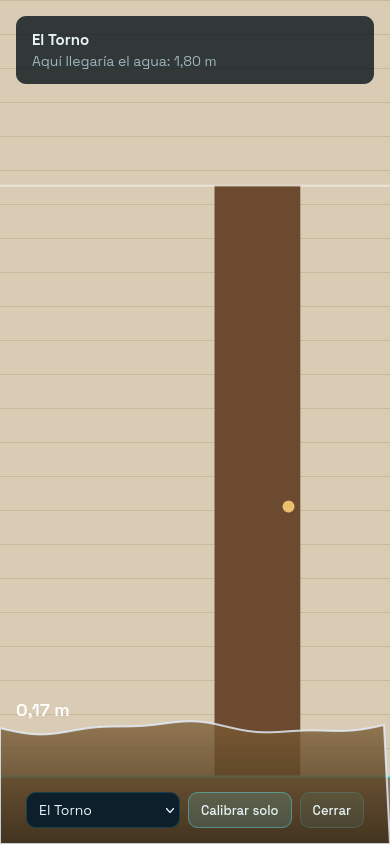
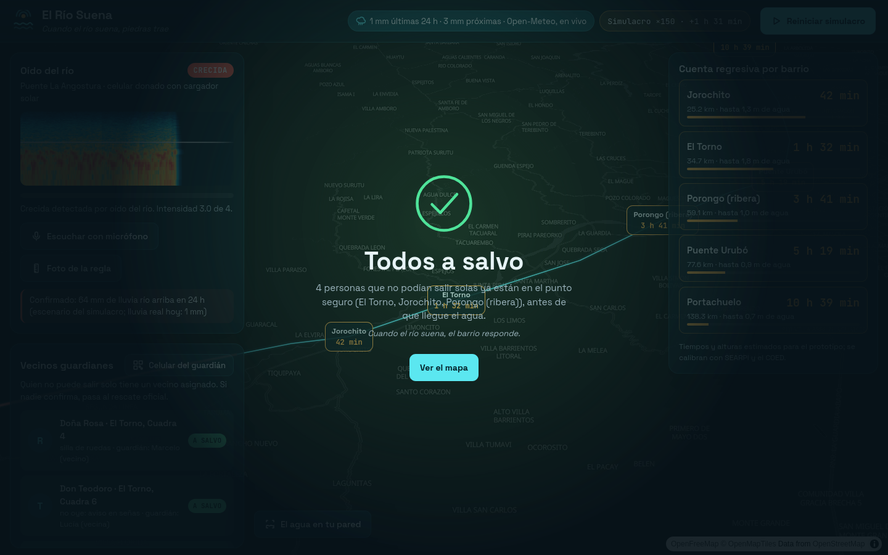
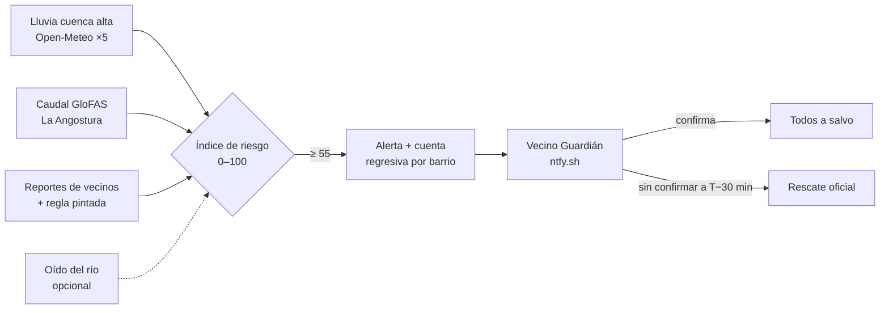

# 🌊 El Río Suena

> **Cuando el río suena, piedras trae.**
> Alerta de crecidas del río Piraí **por barrio** que usa datos abiertos, no necesita sensores y asigna un vecino guardián a cada persona que no puede evacuar sola.


**▶ Demo en vivo:** https://neckhurtttt.github.io/el-rio-suena/?jurado. Tocar **Iniciar simulacro**: en `?jurado` el tiempo corre ×300.
**📱 Celular del guardián:** botón «Celular del guardián» → escanear el QR (`guardian.html?t=<tema>&p=rosa`).

Abstracthon 2026 · Track **Ayuda Tecnológica**, que se cruza con **Emergencias** y **Accesibilidad e inclusión** · Equipo **Birria TECH**

---

## 😟 Problema
Las riadas del Piraí (la de El Torno fue un desastre departamental) y el fenómeno de El Niño 2026-27 ponen en riesgo a los barrios de la ribera. Hoy:

- Las alertas se dan **por colores y para todo el departamento**. Ninguna le dice a una cuadra concreta **cuánto tiempo le queda**.
- Muchas familias **no evacúan porque no creen** que el agua vaya a llegar a su casa.
- Los adultos mayores, las personas en silla de ruedas, las personas sordas y los niños solos dependen de que **alguien se acuerde de ellos**.

## 💡 Solución en 4 piezas

| | Pieza | Qué hace |
|---|---|---|
| 🛰️ | **Vigía del Piraí** | Cada 10 min revisa la lluvia en 5 puntos de la cuenca alta (Open-Meteo), el caudal GloFAS en La Angostura y los reportes de vecinos. Con eso calcula un **índice de riesgo de 0 a 100**. |
| ⏱️ | **Cuenta regresiva por barrio** | Mide la distancia sobre el cauce real del río (OSM) y muestra avisos como «el agua llega a El Torno en **2 h 20 min**». |
| 📷 | **El agua en tu pared** | Apuntas la cámara a tu casa y la app dibuja hasta dónde subiría el agua. Si no hay cámara, la muestra sobre una pared dibujada. |
| 🤝 | **Vecino Guardián** | Cada persona vulnerable tiene un vecino asignado. Cuando hay alerta, el celular del guardián suena y vibra, y el guardián confirma con un toque. **Si nadie confirma 30 min antes de que llegue el agua, el caso pasa al rescate oficial.** |

**Extra opcional:** el *oído del río*. Un celular junto a la orilla escucha el rugido grave del agua (20–300 Hz).

### ¿Por qué funciona? La ventaja de 2 h 30 min
La lluvia que cae en la cuenca alta (Samaipata, Bermejo, Cuevas…) tarda unas **2 h 30 min** en bajar hasta La Angostura. Si se mira **donde llueve** y no donde ya creció el río, se gana ese tiempo para evacuar.

## 🎬 Demo en 1 minuto (guion para el jurado)
1. Abrir `?jurado` → **Iniciar simulacro**: cae una tormenta en la cuenca alta.
2. El índice supera 55 → **ALERTA**, y cada barrio de la ribera muestra su cuenta regresiva.
3. El celular del guardián (QR) suena → toca **«Ya la ayudé ✓»**.
4. Cuando todos los guardianes confirman → pantalla **«Todos a salvo»**.

| Alerta | Celular del guardián | Agua en la pared | Todos a salvo |
|---|---|---|---|
|  |  |  |  |

## ⚙️ Cómo funciona



- **Web estática, sin backend:** se publica en GitHub Pages y abre en cualquier celular.
- **Mapa:** MapLibre + OpenFreeMap, con el cauce real del Piraí sacado de OpenStreetMap.
- **Índice:** `indiceRiesgo` en `js/datos.js`. Si los únicos datos son reportes de vecinos, el índice **no** dispara la alerta, solo deja la zona en vigilancia (así se evitan las falsas alarmas).
- **Audio:** Web Audio con una FFT de 4096 muestras. Compara la energía entre 20 y 300 Hz con la línea base y avisa si la subida dura 1,5 s seguidos.
- **Canal a los guardianes:** ntfy.sh (pub/sub, también llega a la app ntfy), con BroadcastChannel como respaldo.
- **Plan B sin internet:** lluvia de respaldo, mapa liso, pared dibujada y simulacro con audio sintetizado. **La demo no se cae.**

## 📁 Estructura
```
index.html        app principal (mapa, índice, alerta, pared)
guardian.html     pantalla del celular del guardián
js/datos.js       barrios, guardianes de ejemplo, índice de riesgo
js/lluvia.js      Vigía: Open-Meteo (lluvia) + GloFAS (caudal)
js/mapa.js        MapLibre + cuenta regresiva sobre el cauce
js/cauce-pirai.js cauce del Piraí (OSM)
js/oido.js        oído del río (micrófono)
js/pared.js       el agua en tu pared (cámara)
js/canal.js       ntfy.sh + BroadcastChannel
pruebas.mjs       8 pruebas (índice, tiempos, canal)
```

## 🚀 Correrlo
```bash
python3 -m http.server 8765    # http://localhost:8765/?jurado
node pruebas.mjs               # 8 pruebas ok
```
- La cámara y el micrófono necesitan HTTPS o localhost.
- `?x=60` cambia la aceleración del tiempo (por defecto ×300 en `?jurado`).

## 🗺️ Lo que sigue
- [ ] Calibrar tiempos y alturas con **SEARPI** y el **COED**.
- [ ] Probar el canal ntfy con 2 celulares reales y un servidor ntfy propio.
- [ ] Avisos en **video LSB** y audios en **quechua y guaraní** grabados por hablantes.
- [ ] Registro de guardianes por junta vecinal.

## 🧭 Honestidad
- Las distancias, las velocidades y las alturas son **estimadas** hasta que se calibren con datos oficiales.
- El sistema **complementa** a las estaciones oficiales; no las reemplaza. La detección acústica es un prototipo, aunque el monitoreo acústico de crecidas sí se estudia en investigación.
- Las personas de la demo son ficticias. El tema público de ntfy sirve solo para la demo.

## 👥 Equipo Birria TECH
Sergio (desarrollo) · José Miguel Salinas (pitch) · Rodrigo Camacho (tester) · Deron Zuñiga (programación)

**Datos:** Open-Meteo (pronóstico y Flood API/GloFAS) · © colaboradores de OpenStreetMap · OpenFreeMap.
