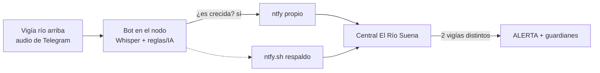

# Nodo comunitario

Una PC de la junta vecinal o del COED que funciona como **servidor de la comunidad**, sin depender de una nube extranjera ni pagar por mensaje:

| Pieza | Qué hace |
|---|---|
| **ntfy propio** | Los avisos a guardianes y vigías salen de un servidor de la comunidad. La app escucha y publica a la vez en este servidor y en ntfy.sh: si uno se cae, el otro sigue. |
| **Túnel de Cloudflare** | Publica ese ntfy en internet con `https`, sin abrir puertos del router. |
| **Vigía por Telegram** | El vigía río arriba manda un **audio** («el río está creciendo, ya tapa la piedra grande»). **Whisper** lo transcribe en esta PC, se decide si es un reporte de crecida y, si lo es, la central lo cuenta como vigía. No hace falta instalar ninguna app. |
| **IA local (opcional)** | Un modelo pequeño con **Ollama** clasifica el reporte. Sin él, el bot usa reglas en castellano boliviano («crece», «viene turbio», «mazamorra», «tapa la piedra»…). |



**Lo que no cambia:** hacen falta **dos vigías distintos** para lanzar la alerta, y solo cuentan los vigías **dados de alta por la junta**. La IA no decide sola: transcribe, clasifica y muestra lo que dijo el vigía en la central.

## Qué necesita la PC

- Windows 10/11 con **Docker Desktop** (usa WSL2), o Linux con Docker.
- **8 GB de RAM** como mínimo; **16 GB** si se usa la IA local (Ollama).
- Internet: para Telegram y para el túnel. La app de la central sigue funcionando sin internet (PWA + SMS); el bot no.
- **Tarjeta NVIDIA (opcional).** Sin ella, Whisper *small* tarda unos segundos por audio y el modelo de 3B, de 5 a 15 s por reporte.

## Instalación rápida en Windows (un comando)

Con **Docker Desktop** instalado y abierto, en PowerShell desde la carpeta del repositorio:

```powershell
powershell -ExecutionPolicy Bypass -File nodo\instalar.ps1
```

El script pide el token del bot y la clave de la junta, y guarda la configuración en `nodo\.env`. Después levanta ntfy, el túnel, el bot y la IA local, y descarga Whisper y `qwen2.5:3b`. Al final **abre la central ya conectada al nodo**; la dirección queda en `nodo\datos\central.txt`. Se puede volver a correr cuando se quiera: si `.env` ya existe, no pregunta nada.

**PC de referencia del equipo:** Intel Core i9-13900, 32 GB de RAM y gráfica integrada, sin NVIDIA; todo corre en el procesador. Tiempos estimados, a confirmar en la primera prueba:

| Tarea | Modelo | Tiempo |
|---|---|---|
| Transcribir un audio de 10 s | Whisper *small* | 1 a 3 s |
| Decidir si el reporte es una crecida | `qwen2.5:3b` | 2 a 5 s |

## Instalación paso a paso (Windows o Linux)

1. **Bot de Telegram.** En Telegram, hablar con **@BotFather** → `/newbot` → guardar el *token*.
2. **Configuración.** En la carpeta `nodo/`, copiar `.env.ejemplo` a `.env` y completar:
   - `TELEGRAM_TOKEN`: el token del paso 1. No se comparte por chat ni se sube a GitHub.
   - `TEMA`: el tema del canal, por ejemplo `rio-suena-eltorno`.
   - `JUNTA_CLAVE`: la clave que la junta les pasa a los vigías.
3. **Arrancar:**
   ```bash
   cd nodo
   docker compose up -d --build
   ```
   Con IA local:
   ```bash
   docker compose --profile ia up -d --build
   docker compose exec ollama ollama pull qwen2.5:3b
   ```
   y en `.env`: `OLLAMA_URL=http://ollama:11434`.
4. **Ver la dirección pública del ntfy de la comunidad:**
   ```bash
   docker compose logs tunel | grep trycloudflare
   ```
   Aparece algo como `https://palabras-al-azar.trycloudflare.com`. Esa URL cambia cada vez que se reinicia el túnel; para una fija, ver *Túnel con dirección fija*.
5. **Abrir la central** con el mismo tema y el ntfy propio:
   ```
   https://neckhurtttt.github.io/el-rio-suena/?jurado&t=rio-suena-eltorno&ntfy=https://palabras-al-azar.trycloudflare.com
   ```
   Para dejarlo fijo, poner la dirección en `NTFY_PROPIO` de `js/config.js`.
6. **Dar de alta a los vigías.** Cada vigía abre el bot en Telegram y escribe:
   ```
   /alta <clave de la junta> bermejo
   ```
   Puestos: `bermejo`, `espejos`, `samaipata`, `angostura`. Los vigías quedan en `nodo/datos/vigias.json`.

## Probarlo en vivo

1. Abrir la central (paso 5) y el bot en dos celulares de vigías dados de alta.
2. Vigía 1 manda un audio: *«el río está creciendo, ya tapa la piedra grande»*. El bot responde con lo que entendió y la central muestra **Vigía en Bermejo** con la transcripción.
3. Vigía 2 manda otro audio desde otro puesto → **ALERTA**, y suenan los celulares de los guardianes.

**Plan B para el pitch:** tener el audio grabado de antemano y reenviarlo con un toque. Si falla la red, la central sigue teniendo los botones «Vigía río arriba» y «QR vigía».

## Túnel con dirección fija

Con una cuenta gratuita de Cloudflare: *Zero Trust → Networks → Tunnels → Create tunnel*, apuntar el *public hostname* a `http://ntfy:80`, copiar el token y en `.env`:

```
CLOUDFLARE_TOKEN=<token del túnel>
CLOUDFLARE_CMD=tunnel --no-autoupdate run
```

## Comandos útiles

```bash
docker compose logs -f vigia     # qué entiende el bot de cada audio
docker compose restart vigia     # tras cambiar .env
docker compose down              # apagar el nodo
```

Pruebas del bot (sin red ni Whisper):

```bash
cd nodo/bot && python -m unittest test_bot.py
```

## Límites, dichos claro

- La transcripción automática puede equivocarse con ruido de río o lluvia. Por eso el vigía recibe la respuesta del bot con lo que entendió, y la central muestra el texto.
- El clasificador por reglas está pensado para el castellano de la zona. Audios en quechua o guaraní todavía no se transcriben bien con Whisper *small*.
- Telegram se eligió para el prototipo porque su API es gratuita. En Bolivia se usa más WhatsApp, que se puede sumar después con su API oficial.
- Un nodo es un solo punto de falla. Por eso la app publica a la vez en ntfy.sh.
